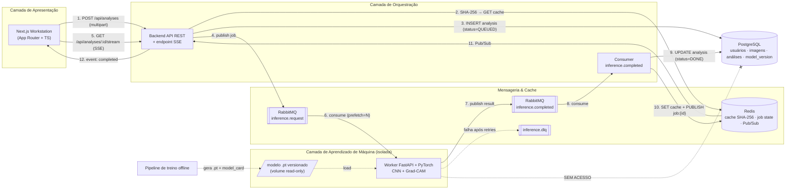
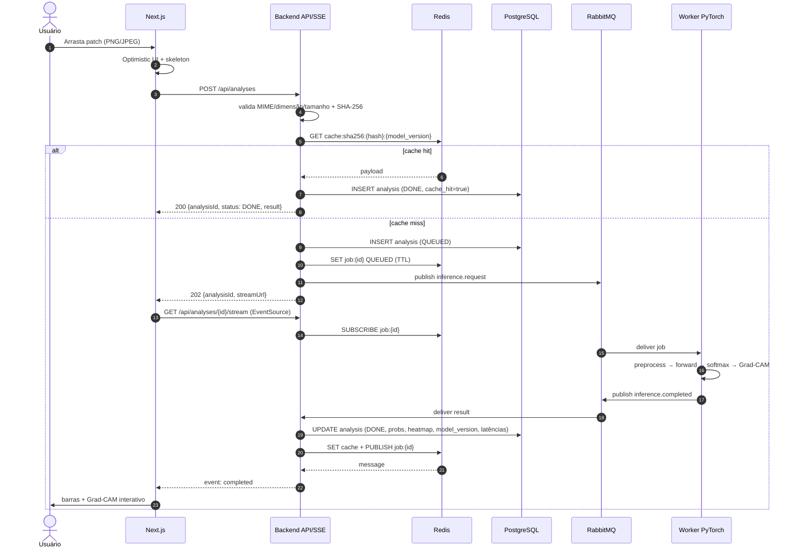
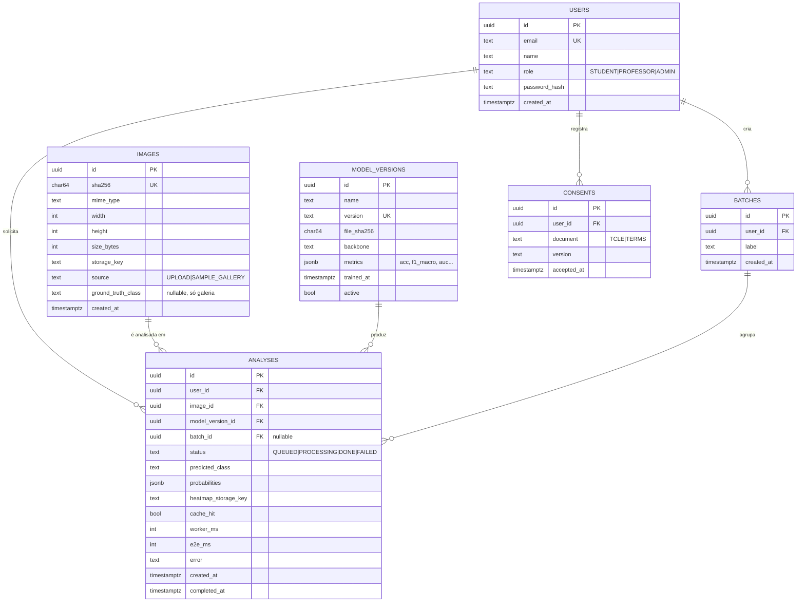

# CLAUDE.md — TCC: Reconhecimento Automatizado de Padrões Histológicos em Câncer Colorretal com IA

> Este arquivo é a fonte de verdade do projeto. Ele **sobrepõe** qualquer `CLAUDE.md` de diretórios pais
> (ex.: `/home/paulo/Downloads/CLAUDE.md`, que trata de outro projeto e NÃO se aplica aqui).
> Documento-base do conteúdo acadêmico: `docs/TCC_Pré_ (1).pdf` (Pré-TCC, set/2026).

---

## 0. Identificação

| Campo | Valor |
|---|---|
| Autor | Paulo Victor Silva Gonçalves |
| Curso / IES | Engenharia de Software — Universidade de Vassouras (UVS), Campus Maricá |
| Ano | 2026 |
| Nome da ferramenta | **HistoLente** — estudo explicável de padrões histológicos do câncer colorretal (repositório: https://github.com/Umizin/histolente) |
| Título | Reconhecimento Automatizado de Padrões Histológicos em Câncer Colorretal com Inteligência Artificial: Uma Ferramenta de Apoio à Patologia Digital |
| Metodologia | Design Science Research (DSR) + Scrum (sprints de 2 semanas) |
| Dataset | NCT-CRC-HE-100K (Kather et al., 2018) — 100.000 patches H&E 224×224 px, 86 lâminas, 9 classes |
| Explicabilidade | Grad-CAM (Selvaraju et al., 2017) |
| Marco regulatório | Resolução CFM nº 2.454/2026; LGPD (Lei nº 13.709/2018) |

### 0.1 Problema
- Brasil: 4.424 patologistas → **2,08 por 100 mil hab.**, contra 5–6/100 mil recomendados pela OMS (SBP, 2025 / Demografia Médica 2025).
- Desigualdade regional: SP concentra 1.468; **Região Norte inteira tem 177** (PA 65, AM 34, RO 24, TO 24, RR 11, AC 10, AP 9).
- Scanners WSI e microscópios digitais são inacessíveis para laboratórios menores em países de baixa/média renda (Zehra et al., 2023).

### 0.2 Lacunas (Seção 1.8 do Pré-TCC)
1. Soluções de IA em patologia digital concentradas em contextos de alto orçamento.
2. Escassez de ferramentas de **apoio pedagógico** para reconhecimento de padrões histológicos.
3. Necessidade de explicabilidade acessível a não especialistas.

### 0.3 Artefato (objeto do DSR)
Workstation web de alta performance e baixa latência, para **apoio pedagógico** (estudantes de Medicina e professores de Patologia da UVS) e **triagem assistida** (nunca diagnóstico), que classifica patches H&E 224×224 nas 9 classes do NCT-CRC-HE-100K e exibe o mapa Grad-CAM de forma interativa.

### 0.4 Classes do dataset (ordem canônica do índice de saída do modelo — NÃO alterar)

| Idx | Sigla | Nome PT-BR | Morfologia-chave (base para tooltips) |
|---|---|---|---|
| 0 | ADI | Tecido adiposo | Adipócitos grandes, citoplasma "vazio" (lipídio removido no processamento), núcleos achatados periféricos, padrão em favo de mel |
| 1 | BACK | Fundo (background) | Área sem tecido / vidro, artefatos de lâmina; sem estrutura celular |
| 2 | DEB | Detritos (debris) / necrose | Restos celulares, cariorrexe, picnose, material eosinofílico amorfo, frequentemente necrose "suja" intraluminal |
| 3 | LYM | Linfócitos | Células pequenas, redondas, núcleo denso hipercromático ocupando quase toda a célula, citoplasma escasso, alta celularidade |
| 4 | MUC | Muco | Material extracelular azul-acinzentado/pálido, frouxo, pouco celular |
| 5 | MUS | Músculo liso | Fibras fusiformes eosinofílicas em feixes, núcleos alongados "em charuto" |
| 6 | NORM | Mucosa colônica normal | Criptas regulares, células caliciformes, núcleos basais alinhados, polaridade preservada |
| 7 | STR | Estroma associado ao câncer | Tecido conjuntivo desmoplásico, fibroblastos, matriz eosinofílica, sem epitélio |
| 8 | TUM | Epitélio de adenocarcinoma | Glândulas irregulares/cribriformes, núcleos aumentados, pleomórficos, estratificados, perda de polaridade, mitoses |

> Ordem alfabética = ordem do `torchvision.datasets.ImageFolder`. Qualquer mudança quebra o contrato de mensageria e o histórico.

---

## 1. Arquitetura (3 domínios, orientada a eventos)

### 1.1 Princípios inegociáveis
1. **Worker de IA NÃO acessa o PostgreSQL** (RNF06). Ele não tem credenciais de banco, não tem driver de banco instalado e não está na rede Docker do Postgres.
2. **Persistência exclusiva no Backend de Orquestração.** Só ele escreve/lê o PostgreSQL.
3. **Comunicação Backend ↔ Worker apenas por RabbitMQ** (`inference.request` / `inference.completed`) com contrato JSON versionado.
4. **Entrega ao navegador via SSE** alimentado por Redis Pub/Sub — sem polling.
5. **Cache por SHA-256** do conteúdo binário da imagem: hit no Redis → resposta imediata, sem enfileirar.
6. **Rastreabilidade do modelo:** toda análise grava `model_version` + `model_sha256` do arquivo `.pt`.
7. Decisão clínica é humana (CFM 2.454/2026). O sistema **nunca** emite termo de laudo ("diagnóstico", "laudo", "confirmado").

### 1.2 Domínios

| Domínio | Tecnologia | Responsabilidades | NÃO pode |
|---|---|---|---|
| **Apresentação** | Next.js (App Router, TS estrito), Tailwind, shadcn/ui, Framer Motion, Lucide | Upload (único/lote), galeria de amostras, visualizador (slider de opacidade, side-by-side, zoom/pan sincronizado), barras de confiança + tooltips, histórico, banner ético, consumo SSE | Chamar o Worker diretamente; guardar segredo no cliente |
| **Orquestração** | API REST + endpoint SSE (Next.js Route Handlers **ou** serviço Node/NestJS/Fastify — decisão registrada em ADR), Prisma/Drizzle | Auth, validação (MIME, dimensão, tamanho), hash SHA-256, consulta cache Redis, persistência PostgreSQL, publicação em `inference.request`, consumo de `inference.completed`, publicação Redis Pub/Sub, stream SSE | Executar inferência; carregar PyTorch |
| **Aprendizado de Máquina** | Python 3.11+, FastAPI (health/metrics/readiness), PyTorch, consumidor AMQP (aio-pika) | Consumir job, pré-processar, inferir, Grad-CAM, publicar resultado; expor `/healthz`, `/readyz`, `/metrics`, `/model` | Conectar ao Postgres; persistir imagem; conhecer usuário |
| **Treinamento offline** | Python, PyTorch, scikit-learn, notebooks/scripts reprodutíveis | Treino, validação, teste, geração de `.pt` versionado + `model_card.json` | Rodar no fluxo de produção |

### 1.3 Diagrama de fluxo (Event-Driven + SSE)



### 1.4 Diagrama de sequência



### 1.5 Contratos de mensageria (v1)

`inference.request` (exchange `inference`, tipo `direct`, durável; fila durável, `x-dead-letter-exchange=inference.dlx`):
```json
{
  "schema_version": "1.0",
  "job_id": "uuid-v4",
  "analysis_id": "uuid-v4",
  "image_sha256": "hex-64",
  "image_b64": "<PNG/JPEG base64; patch ≤ 224x224 ~ <100KB>",
  "mime_type": "image/png",
  "requested_at": "ISO-8601 UTC",
  "target_class": null,
  "correlation_id": "uuid-v4"
}
```

`inference.completed`:
```json
{
  "schema_version": "1.0",
  "job_id": "uuid-v4",
  "analysis_id": "uuid-v4",
  "status": "DONE | FAILED",
  "model": { "name": "resnet50-nct", "version": "1.2.0", "sha256": "hex-64" },
  "predicted_class": "TUM",
  "probabilities": { "ADI": 0.001, "BACK": 0.0, "DEB": 0.004, "LYM": 0.002, "MUC": 0.0, "MUS": 0.01, "NORM": 0.03, "STR": 0.05, "TUM": 0.903 },
  "gradcam": { "target_layer": "layer4", "heatmap_png_b64": "...", "colormap": "jet|turbo|viridis", "resolution": [224, 224] },
  "timings_ms": { "preprocess": 3, "inference": 41, "gradcam": 58, "total_worker": 104 },
  "error": null,
  "completed_at": "ISO-8601 UTC",
  "correlation_id": "uuid-v4"
}
```
Regras: `probabilities` soma 1 ± 1e-4; mensagens idempotentes por `job_id` (consumidor ignora duplicata); `ack` manual só após processamento; até 3 retries com backoff → DLQ; `prefetch_count` = nº de slots de GPU/CPU (protege contra OOM).

### 1.6 Chaves Redis
| Chave | Conteúdo | TTL |
|---|---|---|
| `cache:sha256:{hash}:{model_version}` | payload `inference.completed` | 7 dias |
| `job:{job_id}` | `QUEUED/PROCESSING/DONE/FAILED` + timestamps | 1 h |
| canal Pub/Sub `job:{analysis_id}` | evento de conclusão | — |
| `ratelimit:{user_id}` | contador | 60 s |

> A versão do modelo compõe a chave: trocar o `.pt` invalida o cache automaticamente.

### 1.7 Modelo de dados (PostgreSQL)


Índices: `analyses(user_id, created_at desc)`, `images(sha256)`, `analyses(status)`. Imagens e heatmaps em volume/objeto (`storage_key`), não em `bytea`.

### 1.8 Estrutura de diretórios alvo
```
TCC/
├── CLAUDE.md
├── .claude/{agents,commands}/
├── docs/                     # Pré-TCC (PDF), monografia, ADRs, artefatos de pesquisa
│   ├── monografia/           # capítulos .md (fonte) → exportação ABNT
│   ├── adr/                  # Architecture Decision Records
│   ├── pesquisa/             # TCLE, roteiro, SUS, scripts de tabulação
│   └── diagramas/            # .mmd
├── apps/
│   ├── web/                  # Next.js (Apresentação [+ Orquestração se ADR decidir])
│   └── api/                  # Backend de Orquestração (se serviço separado)
├── services/
│   └── inference/            # Worker Python (FastAPI + PyTorch + consumer AMQP)
├── ml/
│   ├── training/             # scripts de treino, splits, augment, avaliação
│   ├── models/               # .pt + model_card.json (git-lfs ou fora do git)
│   └── reports/              # métricas, matriz de confusão, curvas ROC
├── packages/contracts/       # JSON Schema dos eventos (fonte única p/ TS e Python)
├── infra/                    # docker-compose.yml, configs RabbitMQ/Redis/Postgres
└── tests/                    # e2e (Playwright), carga (k6)
```

---

## 2. Design System — "Clinical Dark Workstation"

### 2.1 Princípios
1. **A lâmina é a protagonista.** Interface neutra e escura para não competir com rosa (eosina) e roxo (hematoxilina).
2. **Sem fadiga visual** em sessões longas de aula: baixo brilho, contraste alto apenas em texto e dados.
3. **Acentos frios (teal/emerald)** — complementares ao rosa/roxo do H&E, nunca confundidos com ele.
4. **Nunca usar vermelho/rosa/roxo como cor de UI** (ruído sobre o H&E). Erro = âmbar/laranja dessaturado + ícone + texto.
5. **Densidade de workstation**, não de landing page: informação próxima, sem rolagem para o essencial em 1366×768.

### 2.2 Tokens (CSS variables / Tailwind)
> Revisados em 25/11/2026 (identidade "Platina", ADR 0006). Valores do tema claro e contrastes em `docs/projeto/04-ux-ui.md` §4.3.

| Token | Valor | Uso |
|---|---|---|
| `--bg` | `#0D1517` | fundo da aplicação (estativa) |
| `--s1` | `#142024` | painéis (platina) |
| `--s2` | `#1B2A2F` | controles, cartões (lamínula) |
| `--border` / `--border-strong` | `#26363C` / `#667E86` | divisória decorativa / borda de controles (≥ 3:1) |
| `--text` | `#E3ECEA` | texto principal (≥ 12:1) |
| `--muted` | `#9AAFAB` | secundário (≥ 6,4:1) |
| `--accent` | `#2BC3AE` (verdete) | ação primária, foco, classe predita |
| `--accent2` | `#43C98E` | acerto, conclusão |
| `--warn` | `#E9B44C` | aviso ético, baixa confiança |
| `--danger` | `#F08A3C` (laranja) | erro (não usar vermelho) |
| Radius | `12px` painéis / `8px` controles / `4px` visualizador | |
| Fonte | Instrument Sans (UI e números), Source Serif 4 (nome da classe, títulos) | `tabular-nums` em percentuais; ícones Lucide |

Tema escuro padrão; tema claro opcional (projetor de sala de aula) com os mesmos tokens redefinidos.

### 2.3 Layout da Workstation (desktop ≥ 1280px)
```
┌──────────────────────────────────────────────────────────────────────────┐
│ ⚠ Banner ético fixo (RF07 · CFM 2.454/2026)                     [i] [✕*] │
├────────────┬──────────────────────────────────────────┬──────────────────┤
│ Sidebar    │  Visualizador                            │ Painel de        │
│ · Upload   │  [Overlay | Lado a lado]  zoom 100% ⟲    │ resultado        │
│ · Galeria  │  ┌──────────────┐ ┌──────────────┐       │ Classe: TUM 90%  │
│   9 classes│  │ patch        │ │ Grad-CAM     │       │ ▇▇▇▇▇▇▇▇▇ TUM   │
│ · Lote     │  │              │ │              │       │ ▇ STR            │
│ · Histórico│  └──────────────┘ └──────────────┘       │ ▏ NORM ... (9)   │
│            │  Opacidade Grad-CAM ──●────── 45%        │ ⓘ tooltips       │
│            │  Colormap [turbo ▾]  Contorno ☐          │ modelo v1.2.0    │
│            │                                          │ 312 ms · cache ✕ │
└────────────┴──────────────────────────────────────────┴──────────────────┘
```
`*` o banner pode ser minimizado para uma faixa de 28px, **nunca removido**.

### 2.4 Componentes obrigatórios
| Componente | Requisito | Detalhes |
|---|---|---|
| `EthicsBanner` | RF07 | fixo no topo, `role="note"`, texto: "Ferramenta educacional e de apoio à triagem. Não substitui laudo anatomopatológico. A decisão clínica é sempre do médico (Res. CFM nº 2.454/2026)." |
| `DropzoneUpload` | RF01 | drag-and-drop + clique + colar (Ctrl+V); PNG/JPEG; ≤ 5 MB; aviso se ≠ 224×224 (redimensiona com aviso); modo lote até 50 |
| `SampleGallery` | RF01/RF02 | 9 cards (1 por classe) + "aleatório"; 1 clique dispara análise; mostra rótulo verdadeiro **após** resultado (modo quiz opcional) |
| `SlideViewer` | RF04 | canvas com zoom (wheel/pinch, 1×–8×), pan (drag), `image-rendering: pixelated` acima de 4×; reset |
| `GradCamOverlay` | RF04 | slider 0–100% (padrão 40%), atualização a 60fps via CSS `opacity` (sem re-render React), colormap selecionável (turbo/viridis — daltônico-amigável), opção de contorno de isolinha para não mascarar núcleos |
| `SideBySide` | RF04 | dois viewers com transform compartilhado (zoom/pan sincronizado) + crosshair espelhado |
| `ConfidenceBars` | RF02/RF03 | 9 barras ordenadas por probabilidade, classe predita em `--accent`, `tabular-nums`, tooltip com morfologia (seção 0.4), aviso âmbar se top-1 < 60% ou margem top1–top2 < 15 p.p. |
| `AnalysisHistory` | RF05/RF06 | tabela paginada, filtro por classe/data/lote, reabrir análise, export CSV |
| `JobStatus` | RNF01 | skeleton durante `QUEUED/PROCESSING`, contador de latência, estado de erro com retry |

### 2.5 Movimento (Framer Motion)
- Durações 150–250 ms, `ease: [0.2, 0, 0, 1]`; barras de confiança animam `scaleX` com stagger 30 ms.
- `prefers-reduced-motion` respeitado (desliga animações não essenciais).
- Nunca animar a imagem histológica (sem blur/scale de entrada) — fidelidade visual.

### 2.6 Acessibilidade e usabilidade (meta SUS > 85)
- WCAG 2.2 AA; foco visível teal 2px; navegação total por teclado (`←/→` slider, `+/-` zoom, `0` reset, `S` side-by-side, `G` galeria).
- Toda cor de dado acompanhada de texto/valor.
- Linguagem do público: "região que mais influenciou o modelo", não "ativação da camada 4".
- Estados vazios didáticos (ex.: galeria sugerida no primeiro acesso).

---

## 3. Requisitos

### 3.1 Funcionais (RF) — base: Pré-TCC Seção 3.3
| ID | Descrição | Critério de aceite verificável |
|---|---|---|
| RF01 | Upload de patch JPEG/PNG (individual, lote e galeria de amostras) | Aceita PNG/JPEG ≤ 5 MB; rejeita outros MIME com mensagem; lote ≤ 50; galeria analisa em 1 clique |
| RF02 | Classificar em uma das 9 classes do NCT-CRC-HE-100K | Saída sempre ∈ {ADI…TUM}; teste com 9 amostras de referência retorna a classe correta |
| RF03 | Exibir confiança por classe | 9 valores somando 100% ± 0,1 p.p.; ordenados; tooltip morfológico por classe |
| RF04 | Gerar e exibir Grad-CAM | Heatmap 224×224 alinhado ao patch; slider 0–100%; side-by-side com zoom/pan sincronizado |
| RF05 | Armazenar histórico de imagens e resultados | Registro em `analyses` com `model_version`, probabilidades, heatmap, latências |
| RF06 | Consultar análises anteriores | Lista paginada com filtros; reabrir análise reproduz a mesma visualização |
| RF07 | Aviso explícito de caráter educacional/triagem (CFM 2.454/2026) | Banner presente em 100% das telas autenticadas; teste E2E falha se ausente |

### 3.2 Não funcionais (RNF) — base: Pré-TCC Seção "3.4" (numerada erroneamente como 2.4)
| ID | Categoria | Métrica / SLA verificável | Como medir |
|---|---|---|---|
| RNF01 | Desempenho | Worker (pré-proc + inferência + Grad-CAM) **p95 < 500 ms**; ponta a ponta upload→evento SSE **p95 < 1,5 s** para patch isolado; cache hit **p95 < 150 ms**; 30 usuários simultâneos sem erro | `timings_ms` no payload; k6 com 30 VUs; histograma Prometheus; relatório com hardware declarado (CPU/GPU) |
| RNF02 | Usabilidade | **SUS médio ≥ 85** (meta), mínimo aceitável 68; tarefa "analisar amostra e interpretar Grad-CAM" concluída por ≥ 90% sem ajuda | Questionário SUS + teste de tarefa moderado |
| RNF03 | Portabilidade | `docker compose up` sobe todo o ambiente em máquina limpa em < 10 min (excluindo download do modelo); funciona com e sem GPU | Checklist em máquina limpa; CI build |
| RNF04 | Privacidade / LGPD | Zero dados pessoais de pacientes; patches anônimos; dados de participantes pseudonimizados; TCLE registrado em `consents`; senhas Argon2/bcrypt; TLS fora do localhost | Revisão de schema; teste que nenhum log contém e-mail/imagem |
| RNF05 | Disponibilidade | ≥ 99% de sucesso das requisições em sessão de demonstração de 60 min; healthchecks em todos os serviços; restart automático; DLQ sem perda de job | k6 soak 60 min; `docker compose ps` healthy |
| RNF06 | Manutenibilidade / desacoplamento | Worker sem dependência/credencial de PostgreSQL (verificado por teste); contrato versionado em JSON Schema; troca de `.pt` sem rebuild do backend; cobertura de testes ≥ 70% em domínio/serviços | Teste de arquitetura (import/env/network); CI |

---

## 4. Convenções de código

### 4.1 Gerais
- **Clean Architecture** por serviço: `domain` (entidades, regras, sem I/O) → `application` (casos de uso) → `infrastructure` (DB, AMQP, Redis, HTTP) → `interfaces` (controllers, rotas, UI). Dependências apontam para dentro.
- Configuração só por variáveis de ambiente (12-factor), validadas no boot (Zod / pydantic-settings). `.env.example` sempre atualizado; nunca commitar `.env`.
- Commits: Conventional Commits (`feat(web): ...`, `fix(inference): ...`, `docs(monografia): ...`), referenciando RF/RNF quando aplicável (`refs RF04`).
- Cada sprint Scrum gera: incremento funcional + atualização da seção correspondente da monografia (ciclo DSR documentado).
- ADR em `docs/adr/NNNN-titulo.md` para toda decisão arquitetural (contexto, decisão, consequências).
- Logs estruturados JSON com `correlation_id` atravessando FE→BE→MQ→Worker.

### 4.2 TypeScript / Next.js
- `"strict": true`, `noUncheckedIndexedAccess`, sem `any` (usar `unknown` + narrowing). ESLint + Prettier.
- Server Components por padrão; `"use client"` só em componentes interativos (viewer, slider, dropzone).
- Validação de entrada com Zod em toda fronteira (route handler, formulário, payload SSE).
- Tipos dos eventos gerados a partir de `packages/contracts` (JSON Schema → TS).
- Testes: Vitest + Testing Library (unidade/componente), Playwright (E2E, incluindo RF07), k6 (carga RNF01).

### 4.3 Python (Worker / Treino)
- Python 3.11+, PEP 8, **type hints obrigatórios**, `mypy --strict`, `ruff` (lint+format).
- Pydantic v2 para contratos (gerados/validados contra o JSON Schema).
- `torch.inference_mode()`, modelo em `eval()`, carregado uma vez no startup; warm-up com tensor dummy antes de `readyz` responder OK.
- Determinismo no treino: seeds fixas (`random`, `numpy`, `torch`, `cudnn.deterministic`), splits salvos em CSV.
- Testes: pytest (unidade do pré-processamento, Grad-CAM shape/range [0,1], soma de probabilidades), teste de contrato do payload, teste de arquitetura (nenhum import de `psycopg`/`sqlalchemy`/`asyncpg`).

### 4.4 Docker
- Imagens multi-stage, usuário não-root, `HEALTHCHECK` em todos os serviços, versões fixas de imagem base.
- Redes: `frontend_net` (web↔api), `backend_net` (api↔postgres), `mq_net` (api↔rabbitmq↔worker↔redis). **Worker fora de `backend_net`.**
- Modelo `.pt` montado como volume read-only.

---

## 5. Convenções de escrita acadêmica

- **ABNT NBR 14724:2011** (estrutura de trabalhos acadêmicos), **NBR 6023:2018** (referências), **NBR 10520:2023** (citações), NBR 6024 (numeração progressiva), NBR 6027 (sumário), NBR 6028 (resumo).
- Tom **impessoal, 3ª pessoa** ("este trabalho propõe", "observa-se"), sem "eu/nós", sem adjetivação promocional ("revolucionário", "incrível").
- NBR 10520:2023: citação indireta no texto em maiúsculas/minúsculas — "Sommerville (2019)" ou "(SOMMERVILLE, 2019)" é aceito; **ser consistente**. Citação direta curta entre aspas com página; longa (> 3 linhas) recuo 4 cm, fonte menor, sem aspas.
- Toda afirmação factual ou numérica precisa de fonte; toda citação no texto precisa existir nas Referências com **mesmo autor e mesmo ano** — e vice-versa.
- Referências: ordem alfabética, DOI completo quando houver, "Disponível em: ... Acesso em: dd mmm. aaaa." para documentos online.
- Estrangeirismos em itálico (*deep learning*, *patch*, *whole-slide imaging*), com tradução na primeira ocorrência.
- Siglas por extenso na primeira ocorrência (ex.: "Server-Sent Events (SSE)").
- Figuras/tabelas/quadros: título acima, fonte abaixo ("Fonte: elaborado pelo autor (2026)").
- Monografia-fonte em `docs/monografia/*.md`; um arquivo por capítulo.

### 5.1 Referencial teórico de apoio (já citado no Pré-TCC)
Sommerville (2019); Pressman e Maxim (2016 — 8. ed.); Mitchell (1997); Goodfellow, Bengio e Courville (2016); LeCun, Bengio e Hinton (2015); SBP (2025); Niazi, Parwani e Gurcan (2019); Zehra et al. (2023); Litjens et al. (2017); Selvaraju et al. (2017); CFM (2026); Kather et al. (2018); Kather et al. (2019).
Candidatas a inclusão (verificar antes de citar): Hevner et al. (2004) e Peffers et al. (2007) — DSR; Dresch, Lacerda e Antunes Júnior (2015) — DSR em PT-BR; Brooke (1996) e Bangor, Kortum e Miller (2009) — SUS; Macenko et al. (2009) — normalização H&E; He et al. (2016) — ResNet; Tan e Le (2019) — EfficientNet; Schwaber e Sutherland (2020) — Scrum Guide; ISO/IEC/IEEE 29148:2018.

---

## 6. Checklist de correções obrigatórias do Pré-TCC

Status: `[ ]` pendente · `[x]` corrigido (registrar onde).

### 6.1 Correções exigidas
- [x] **C1** — Seção 1.1: texto cita "Pressman e Maxim (2021)", Referências trazem 2016 (8. ed., AMGH). Unificar. Recomendação: manter **2016** (edição efetivamente referenciada), ou trocar a referência para a 9. ed. (AMGH, 2021) se for essa a consultada. → **Corrigido:** Pressman e Maxim (2016) unificado em `docs/monografia/01-referencial-teorico.md` e `90-referencias.md` (confirmar com o autor se a edição consultada é a 8ª).
- [x] **C2** — Seção 1.7: remover marcador órfão "[1.1]" após "nove classes de tecido". → **Corrigido:** `01-referencial-teorico.md`, Seção 1.7.
- [x] **C3** — Requisitos não funcionais numerados "2.4"; corrigir para **3.4** (Capítulo 3). Observação: já existe uma "2.4 Levantamento de requisitos e validação da solução" no Cap. 2. → **Corrigido:** `03-requisitos.md` (Seção 3.4).
- [x] **C4** — Referência Niazi, Parwani e Gurcan (2019): DOI quebrado ("https://doi.org."). Corrigir para `https://doi.org/10.1016/S1470-2045(19)30154-8`. → **Corrigido:** `90-referencias.md`.
- [x] **C5** — Seção 4 (4.1, 4.2, 4.3 e Figura 1): (a) Frontend "Vue 3 ou Next.js" → **Next.js**; (b) **remover** a afirmação de que o serviço de inferência grava no PostgreSQL e consulta o Redis diretamente (4.3 contradiz o RNF06); (c) descrever filas `inference.request`/`inference.completed`, cache SHA-256, Pub/Sub e entrega via **SSE**; (d) substituir a Figura 1 pelo diagrama da seção 1.3 deste arquivo. → **Corrigido:** `04-arquitetura.md` (4.1–4.4 + Figura 2 `docs/monografia/figuras/arquitetura.svg`).
- [x] **C5b** — Seção 2.7 (Materiais): "Frontend: Vue 3 ou Next.js (a definir)" → "Next.js (App Router, TypeScript), Tailwind CSS e shadcn/ui". → **Corrigido:** `02-materiais-metodos.md`, Seção 2.7.

### 6.2 Correções adicionais identificadas na leitura do Pré-TCC
- [x] **A1** — 1.1: "fornece o uma base sólida" → "fornece uma base sólida". → **Corrigido:** `01-referencial-teorico.md`.
- [x] **A2** — 1.1: "do processo que o originou levantamento de requisitos" → inserir dois-pontos/travessão: "do processo que o originou: levantamento de requisitos, ...". → **Corrigido:** `01-referencial-teorico.md`.
- [x] **A3** — 3.1: "consiste por meio de três partes" → "estrutura-se em três frentes" (regência). → **Corrigido:** `03-requisitos.md`, Seção 3.1 (reescrita).
- [x] **A4** — Referência Litjens et al. (2017): formatação quebrada ("ScienceDirect v.42,p.60-88,dez.2017"). Corrigir: "Medical Image Analysis, v. 42, p. 60-88, dez. 2017." → **Corrigido:** `90-referencias.md`.
- [x] **A5** — Referência Selvaraju et al. (2017): aponta para o DOI do arXiv; o trabalho referenciado é o do ICCV → usar `https://doi.org/10.1109/ICCV.2017.74`. → **Corrigido:** `90-referencias.md`.
- [ ] **A6** — *(parcial: "maio" corrigido em LeCun, Niazi e SBP; faltam as datas de acesso de CFM, Kather 2018/2019 e LeCun — o autor precisa informar quando acessou)* — Referências CFM (2026) e Kather et al. (2018/2019), LeCun et al. (2015): incluir "Acesso em:" (online) de forma consistente.
- [x] **A7** — Kather et al. (2018): referência como dataset Zenodo ("v. 0.1" é versão do registro, não volume) — ajustar para padrão de conjunto de dados (NBR 6023:2018, documento digital). → **Corrigido:** `90-referencias.md`.
- [x] **A8** — RNF01 sem métrica ("tempo compatível com uso interativo") → substituir pela métrica da seção 3.2 (p95 < 500 ms worker; p95 < 1,5 s ponta a ponta). → **Corrigido:** `03-requisitos.md`, Quadro 3.
- [x] **A9** — RF01/RF02/RF03: refletir upload em lote, galeria de amostras e tooltips morfológicos. → **Corrigido:** `03-requisitos.md`, Quadro 2.
- [ ] **A10** — 2.1: positivismo + DSR — explicitar coerência (DSR é pragmático; justificar a validação quanti-qualitativa).
- [ ] **A11** — 2.3: detalhar o mapeamento ciclos DSR (Peffers et al., 2007: identificação do problema → objetivos → design/desenvolvimento → demonstração → avaliação → comunicação) ↔ sprints Scrum.
- [x] **A12** — 1.8 → conferir se cada lacuna é endereçada explicitamente por um RF/RNF (matriz de rastreabilidade). → **Corrigido:** `03-requisitos.md`, Seção 3.7 + Apêndice C.
- [ ] **A13** — Sem Resumo/Abstract, Introdução, Objetivos (geral/específicos), Justificativa, Cronograma — exigidos pela NBR 14724 na versão final.
- [ ] **A14** — "Ambiente de desenvolvimento: Cursor" (2.7): atualizar para refletir as ferramentas efetivamente usadas (incluindo Claude Code), com declaração de uso de IA generativa conforme política da UVS.

---

## 7. Agentes e comandos deste repositório

### Agentes (`.claude/agents/`)
| Agente | Papel |
|---|---|
| `banca-orientador-metodologico` | Presidente da banca: DSR, Scrum, ética (CEP/TCLE/LGPD), ABNT |
| `banca-engenharia-software` | Arquitetura, requisitos (ISO 29148), DevOps, mensageria, UX/performance |
| `banca-ia-visao-computacional` | Deep learning, patologia computacional, Grad-CAM, rigor estatístico |
| `banca-clinico-pedagogico` | Patologista/professor: valor pedagógico, morfologia, CFM 2.454/2026 |
| `sub-redator-academico` | Ghostwriter acadêmico ABNT |
| `sub-arquiteto-fullstack-ml` | Desenvolvedor principal full-stack + ML + infra |

### Comandos (`.claude/commands/`)
| Comando | Uso |
|---|---|
| `/banca-sabatina <arquivo|dir>` | Avaliação simultânea dos 4 avaliadores + notas + perguntas de defesa |
| `/auditar-abnt [arquivo|dir]` | Auditoria/correção ABNT e consistência de citações |
| `/refinar-requisitos-arquitetura` | Reescreve RF/RNF e Seção 4 + diagramas Mermaid |
| `/gerar-artefatos-pesquisa` | TCLE, roteiro de entrevista, SUS + script de tabulação |
| `/sincronizar-codigo-tcc <módulo>` | Código implementado → seção da monografia |
| `/prototipar-workstation-ui [componente]` | Constrói/refina a UI Next.js com revisão clínica |

---

### Geração de documentos (`tools/`)
- `python3 -I tools/diagramas.py` → regenera `docs/engenharia-requisitos/casos-de-uso.svg` e `docs/monografia/figuras/arquitetura.svg`.
- `python3 -I tools/mermaid_svg.py` → converte os blocos Mermaid de `docs/projeto/*.md` em SVG (`docs/projeto/figuras/`), usando o Chrome headless com Mermaid 11.4.1.
- `python3 -I tools/md2pdf.py monografia|requisitos|projeto|gestao|todos` → gera `docs/monografia/monografia-versao-trabalho.pdf` (capítulos `docs/monografia/NN-*.md`, em ordem) e `docs/engenharia-requisitos/artefatos-engenharia-requisitos.pdf`; o alvo `gestao` também copia o PDF para `entregas/gestao-e-desenvolvimento/` (pasta ignorada pelo Git; o material vai pelo AVA). Usa o Chrome headless; sem dependências externas.
- Os apêndices da monografia (`95-apendices.md`) usam `@@incluir arquivo.md | Título da seção@@` para puxar o conteúdo do documento de requisitos e do roteiro — **fonte única**: edite o original, não a cópia.

## 8. Regras para o Claude neste repositório
1. Ler este arquivo e o Pré-TCC (`docs/`) antes de produzir texto ou arquitetura.
2. Nunca inventar referências, DOIs, números ou dados de pesquisa. Se não houver fonte verificada, marcar `[FONTE PENDENTE]`.
3. Nunca gerar resultados de métricas/SUS fictícios como se fossem reais; usar placeholders `[[RESULTADO A COLETAR]]`.
4. Não alterar o PDF original; trabalhar sobre `docs/monografia/*.md` ou `.docx` derivado.
5. Respeitar o RNF06 em qualquer código: o Worker nunca recebe credenciais de banco.
6. Linguagem da UI e da monografia: português do Brasil.
7. Ao concluir uma tarefa, atualizar o checklist da seção 6 quando aplicável.
