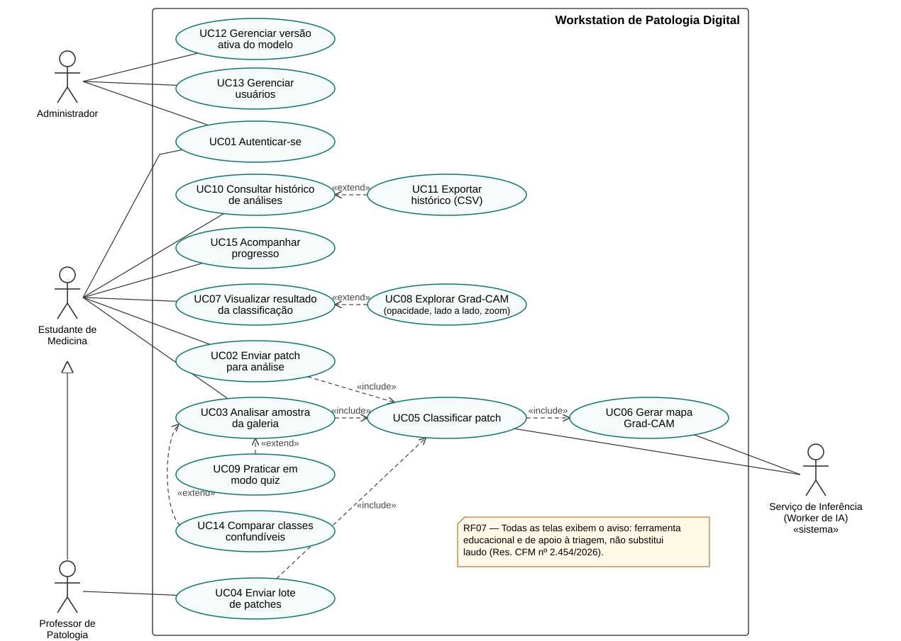

# Artefatos de Engenharia de Requisitos

**Projeto:** Reconhecimento Automatizado de Padrões Histológicos em Câncer Colorretal com Inteligência Artificial: Uma Ferramenta de Apoio à Patologia Digital
**Autor:** Paulo Victor Silva Gonçalves — Engenharia de Software, Universidade de Vassouras (UVS), Campus Maricá
**Versão do documento:** 1.0 — 10/11/2026
**Base:** Pré-TCC (set. 2026), análise do dataset NCT-CRC-HE-100K (KATHER et al., 2018), Resolução CFM nº 2.454/2026, LGPD e decisões de arquitetura registradas no repositório do projeto.

> **Situação da elicitação.** As técnicas documentais (análise de literatura, de normas e do dataset) e as sessões de ideação já foram aplicadas. A **entrevista estruturada escrita**, aplicada remotamente via Google Forms com TCLE integrado, está **em coleta** desde novembro de 2026. A observação de aula e a prototipação estão planejadas. Os requisitos que hoje dependem apenas de ideação estão marcados como **"a validar"** e serão confirmados ou descartados na consolidação das respostas (Seção 1.4).

---

## Sumário
1. Técnicas de elicitação de requisitos
2. Requisitos funcionais (RF) — priorizados por MoSCoW
3. Requisitos não funcionais (RNF)
4. Histórias de usuário e Product Backlog
5. Modelagem UML de requisitos (casos de uso)
6. Matriz de rastreabilidade

---

## 1. Técnicas de elicitação de requisitos

### 1.1 Quadro de técnicas

| Cód. | Técnica | Status | Fonte / participantes | Evidência da aplicação | Requisitos originados |
|---|---|---|---|---|---|
| T1 | **Análise documental e revisão da literatura** | Aplicada (ago.–set./2026) | Sommerville (2019); Pressman e Maxim (2016); Litjens et al. (2017); Niazi, Parwani e Gurcan (2019); Zehra et al. (2023); Selvaraju et al. (2017); SBP (2025) | Capítulo 1 (Referencial Teórico) do Pré-TCC e lista de referências | RF02, RF04, RNF01, RNF03, RNF06, RNF08 |
| T2 | **Análise do dataset público** (estrutura, classes, formato) | Aplicada (set./2026) | NCT-CRC-HE-100K (KATHER et al., 2018): 100.000 *patches* H&E de 224 × 224 px, 9 classes | Seção 1.7 e RF02 do Pré-TCC; tabela de classes no repositório (`CLAUDE.md`, seção 0.4) | RF01, RF02, RF03 |
| T3 | **Análise de normas e regulação** | Aplicada (set./2026) | Resolução CFM nº 2.454/2026; LGPD (Lei nº 13.709/2018) | Seções 1.6 e 2.6 do Pré-TCC | RF07, RF13, RNF04, RNF07 |
| T4 | **Brainstorming / sessões de ideação** | Aplicada (set.–nov./2026) | Autor, com apoio de ferramenta de IA generativa (uso a declarar na monografia) | Registro das decisões em `CLAUDE.md` (05/11/2026) e nos ADRs em `docs/adr/` | RF09, RF10, RF11, RF12, RF14, RNF09 (todos **a validar**) |
| T5 | **Entrevista estruturada escrita, aplicada remotamente** (perguntas abertas + quadro de funcionalidades) | **Em coleta** (nov./2026) | Estudantes de Medicina, professores de Patologia e profissionais de laboratório de anatomia patológica (amostra por conveniência) | Roteiro (`docs/pesquisa/roteiro-entrevista-elicitacao.md`); formulário com TCLE e aceite gerado por `docs/pesquisa/criar-formulario-elicitacao.gs`; planilha de respostas anônimas — consolidação `[[A COLETAR]]` | Validação dos RF "a validar"; priorização MoSCoW; novos requisitos |
| T6 | ~~Questionário separado~~ | Incorporado à T5 | — | O quadro de funcionalidades da T5 cumpre o papel de questionário fechado | — |
| T7 | **Observação** de aula prática de Patologia | Planejada (sujeita à autorização do professor) | Turma de Patologia da UVS | Roteiro de observação e notas de campo — `[[A COLETAR]]` | RF01 (lote), RF09, RNF02, RNF08 |
| T8 | **Prototipação** (protótipo navegável da *workstation*) | Planejada (Sprint 3) | Usuários das técnicas T5 e T7 | Capturas de tela e anotações das sessões — `[[A COLETAR]]` | Refinamento de RF03, RF04 e RNF02 |

### 1.2 Justificativa da combinação
A combinação segue a recomendação de Sommerville (2019): usar várias técnicas complementares, porque nenhuma técnica sozinha revela todos os requisitos. As técnicas documentais (T1–T3) definem o núcleo do problema e as restrições regulatórias. A ideação (T4) gera hipóteses de funcionalidades pedagógicas. As técnicas com usuários (T5–T8) validam essas hipóteses, priorizam o backlog e alimentam o ciclo de avaliação do Design Science Research.

### 1.3 Protocolo resumido das técnicas planejadas
- **T5 — Entrevista estruturada escrita:** formulário online de cerca de 10 minutos, sem gravação e sem coleta de nome ou e-mail. O TCLE é apresentado na primeira página, e só quem aceita acessa as perguntas. Há um desvio por perfil (estudante, professor, profissional de laboratório), 6 perguntas abertas (dificuldades, tecidos confundidos, uso pretendido, mapa de calor, origem das imagens, condições de confiança) e um quadro com 6 funcionalidades classificadas como Essencial, Útil ou Dispensável. As respostas abertas são analisadas por categorias temáticas; o quadro é tabulado por frequência.
- **T7 — Observação:** observação não participante de uma aula prática de 50 minutos. Registro de tarefas, dificuldades e recursos usados, sem identificação de alunos.
- **Pré-requisito ético:** aceite do TCLE (T5, T7 e T8) e confirmação da necessidade de registro no CEP via Plataforma Brasil (Pré-TCC, Seção 2.6).
- **Ajuste de população:** a inclusão de profissionais de laboratório amplia a população descrita no Pré-TCC (Seção 2.5, só professores e estudantes). As Seções 2.5 e 3.1 devem ser atualizadas na monografia.

### 1.4 Consolidação das respostas da T5 *(a preencher ao fim da coleta)*

| Perfil | Respostas recebidas |
|---|---|
| Estudantes (E) | `[[A COLETAR]]` |
| Professores (P) | `[[A COLETAR]]` |
| Profissionais de laboratório (L) | `[[A COLETAR]]` |

| Funcionalidade do quadro | Essencial | Útil | Dispensável | Decisão MoSCoW | Requisito |
|---|---|---|---|---|---|
| Confiança das 9 classes | | | | | RF03 |
| Mapa de calor com transparência e lado a lado | | | | | RF04 |
| Critérios morfológicos e o que não confundir | | | | | RF03, RF15 |
| Galeria com vários exemplos por classe | | | | | RF01 |
| Quiz com erro explicado | | | | | RF09 |
| Histórico e acompanhamento de progresso | | | | | RF06, RF16 |

| Tema das respostas abertas | Síntese | Participantes (códigos) | Impacto nos requisitos |
|---|---|---|---|
| Dificuldades atuais | | | |
| Tecidos mais confundidos | | | |
| Uso pretendido | | | |
| Mapa de calor | | | |
| Origem das imagens | | | RF17 |
| Condições de confiança | | | |
| Requisitos novos | | | |

---

## 2. Requisitos funcionais (RF)

Prioridade pelo método **MoSCoW**: **M** = *Must have* (obrigatório para o MVP); **S** = *Should have* (importante, mas não bloqueia o MVP); **C** = *Could have* (desejável); **W** = *Won't have* (fora do escopo desta versão).
Os requisitos RF01–RF07 vêm do Pré-TCC. Os requisitos RF08–RF17 foram identificados depois e estão **propostos**.

| ID | Requisito | Prioridade | Origem | Critério de aceite |
|---|---|---|---|---|
| RF01 | O sistema deve permitir o envio de *patches* histológicos nos formatos PNG ou JPEG, individualmente, em lote ou pela galeria de amostras. | **M** | T2, T4 | Aceita PNG/JPEG de até 5 MB; rejeita outros formatos com mensagem explicativa; lote de até 50 imagens; galeria com várias amostras por classe, analisadas com 1 clique. |
| RF02 | O sistema deve classificar a imagem em uma das nove classes do NCT-CRC-HE-100K (ADI, BACK, DEB, LYM, MUC, MUS, NORM, STR, TUM). | **M** | T1, T2 | A classe sugerida pertence sempre ao conjunto das 9 classes; as 9 amostras de referência da galeria são classificadas corretamente. |
| RF03 | O sistema deve exibir o nível de confiança de cada uma das nove classes, com descrição morfológica de cada classe. | **M** | T2, T4 | Exibe 9 valores que somam 100% (± 0,1 p.p.), ordenados do maior para o menor; cada classe tem *tooltip* com critérios morfológicos. |
| RF04 | O sistema deve gerar e exibir o mapa de calor Grad-CAM sobreposto ao *patch*, com controle de opacidade e modo lado a lado. | **M** | T1 | Mapa de 224 × 224 px alinhado ao *patch*; controle de opacidade de 0% a 100%; modo lado a lado com zoom e deslocamento sincronizados. |
| RF05 | O sistema deve armazenar o histórico das imagens processadas e seus resultados, incluindo a versão do modelo utilizada. | **M** | T1 | Cada análise registra probabilidades, mapa, versão do modelo, data e tempos de processamento. |
| RF06 | O sistema deve permitir ao usuário consultar e reabrir suas análises anteriores. | **S** | T1 | Lista paginada com filtros por classe, data e lote; reabrir uma análise reproduz a mesma visualização. |
| RF07 | O sistema deve exibir, em todas as telas, aviso de que os resultados têm caráter educacional e de apoio à triagem e não substituem laudo médico. | **M** | T3 | Aviso presente em 100% das telas autenticadas; pode ser minimizado, mas não removido. |
| RF08 *(proposto)* | O sistema deve autenticar usuários e controlar o acesso conforme o perfil (Estudante, Professor, Administrador). | **M** | T3 | Rotas protegidas exigem login; cada perfil acessa apenas as funções permitidas. |
| RF09 *(proposto, a validar)* | O sistema deve oferecer um modo quiz, no qual o estudante escolhe a classe da amostra antes de ver a sugestão do modelo e recebe explicação em caso de erro. | **S** | T4, T5 | O rótulo verdadeiro e a sugestão do modelo só aparecem depois da resposta; em caso de erro, exibe os critérios morfológicos que diferenciam a classe escolhida da correta. |
| RF10 *(proposto, a validar)* | O sistema deve permitir exportar o histórico de análises em formato CSV. | **C** | T4 | O arquivo CSV contém data, classe sugerida, confiança e versão do modelo de cada análise filtrada. |
| RF11 *(proposto)* | O sistema deve exibir a versão do modelo em uso e suas limitações conhecidas. | **S** | T3, T4 | A tela "Sobre o modelo" mostra versão, data de treino, métricas de teste e limitações. |
| RF12 *(proposto, a validar)* | O sistema deve permitir ao Administrador definir a versão ativa do modelo de classificação. | **C** | T4 | Trocar a versão ativa não exige recompilar o backend, e as novas análises registram a nova versão. |
| RF13 *(proposto)* | O sistema deve registrar o aceite do termo de uso (e do TCLE, para participantes da pesquisa) antes do primeiro uso. | **S** | T3 | Sem aceite registrado, a análise não é liberada; o aceite guarda versão do termo e data. |
| RF14 *(proposto)* | O sistema deve informar falhas no processamento e permitir o reenvio da análise. | **S** | T4 | Em caso de falha, o usuário recebe mensagem clara e um botão de reenvio, sem perder o *upload*. |
| RF15 *(proposto, a validar)* | O sistema deve permitir comparar, lado a lado, amostras de duas classes frequentemente confundidas (ex.: STR × MUS, NORM × TUM, DEB × LYM). | **C** | T4, T5 | O usuário escolhe um par de classes e vê amostras da galeria lado a lado, com os critérios que as diferenciam. |
| RF16 *(proposto, a validar)* | O sistema deve exibir ao estudante seu desempenho no modo quiz, por classe e ao longo do tempo. | **C** | T4, T5 | Painel com percentual de acertos por classe e evolução por sessão; dados visíveis apenas ao próprio estudante. |
| RF17 *(proposto)* | O sistema deve alertar quando a imagem enviada parecer fora do padrão do dataset de treino (ex.: foto de celular, coloração diferente de H&E, ausência de tecido). | **S** | T1, T5 | Para imagens fora do padrão, exibe aviso de que o resultado pode não ser confiável antes de mostrar a classificação. |

**Fora do escopo (Won't have nesta versão):**
- Análise de lâmina completa (*whole-slide imaging*).
- Emissão de diagnóstico ou laudo, vedada pela Res. CFM nº 2.454/2026.
- Integração com prontuário eletrônico ou sistema de informação laboratorial.
- Uso de imagens de pacientes reais identificáveis.
- Aplicativo móvel nativo.
- Re-treino do modelo pelo usuário final.
- Identificação ou segmentação de estruturas individuais (núcleo, matriz, célula específica). O Grad-CAM indica apenas regiões de influência na decisão, não rotula estruturas.
- Histologia geral fora das 9 classes de tecido colorretal (ex.: cartilagem, epitélios de outros órgãos).

---

## 3. Requisitos não funcionais (RNF)

Os requisitos RNF01–RNF06 vêm do Pré-TCC, agora com métricas verificáveis. Os requisitos RNF07–RNF09 foram **propostos** para cobrir segurança, compatibilidade e escalabilidade.

| ID | Categoria (ISO/IEC 25010) | Requisito | Métrica / critério | Como medir |
|---|---|---|---|---|
| RNF01 | **Desempenho** | O sistema deve retornar a classificação e o Grad-CAM em tempo compatível com uso interativo. | Serviço de inferência: p95 < 500 ms. Do envio até o resultado na tela: p95 < 1,5 s (*patch* isolado). Imagem já analisada (cache): p95 < 150 ms. | Tempos registrados em cada análise; teste de carga (k6) com hardware declarado |
| RNF02 | **Usabilidade** | A interface deve ser utilizável por pessoas sem conhecimento técnico em IA. | SUS médio ≥ 85 (meta), mínimo aceitável 68; ≥ 90% dos participantes concluem a tarefa principal sem ajuda | Questionário SUS e teste de tarefas |
| RNF03 | Portabilidade | O sistema deve executar em ambiente containerizado. | Todo o ambiente sobe com um único comando (`docker compose up`) em menos de 10 min numa máquina limpa, com ou sem GPU | Checklist em máquina limpa |
| RNF04 | **Segurança — privacidade** | Os dados de participantes devem ser tratados conforme a LGPD. | Nenhum dado de paciente; participantes pseudonimizados; aceite do TCLE registrado; logs sem e-mail nem imagem | Revisão do banco de dados; teste automatizado dos logs |
| RNF05 | **Disponibilidade** | O sistema deve permanecer estável durante aulas e demonstrações. | ≥ 99% de requisições bem-sucedidas em sessão de 60 min; reinício automático de serviços; nenhum pedido de análise perdido em falha | Teste de longa duração (k6); verificação de saúde dos serviços |
| RNF06 | Manutenibilidade | O serviço de IA deve ser separado do backend, com versionamento independente do modelo. | O serviço de IA não tem acesso ao banco de dados; comunica-se apenas por fila de mensagens; troca de modelo sem recompilar o backend; cobertura de testes ≥ 70% | Teste de arquitetura; integração contínua |
| RNF07 *(proposto)* | **Segurança** | O sistema deve proteger contas, sessões e entradas. | Senhas com hash Argon2 ou bcrypt; sessão em cookie `httpOnly`/`Secure`; HTTPS fora do ambiente local; validação do tipo real do arquivo; limite de requisições por usuário; nenhum segredo no código | Testes de integração; checklist OWASP Top 10 |
| RNF08 *(proposto)* | **Compatibilidade** | A interface deve funcionar nos navegadores e equipamentos dos laboratórios de informática. | Versões recentes de Chrome, Edge e Firefox; resolução mínima 1366 × 768; serviço de IA funcional apenas com CPU, sem GPU | Testes automatizados de interface em vários navegadores; teste em máquina do laboratório |
| RNF09 *(proposto)* | **Escalabilidade** | O sistema deve absorver picos de uso simultâneo em aula sem esgotar a memória. | 30 usuários simultâneos sem erro; o número de serviços de IA pode ser aumentado sem mudar o código; a fila controla a carga sobre cada serviço de IA | Teste de carga com 1 e com 2 serviços de IA (k6) |

**Regras de negócio** (referenciadas nos casos de uso):

| ID | Regra |
|---|---|
| RN01 | Formatos aceitos: PNG e JPEG, até 5 MB. Imagens diferentes de 224 × 224 px são redimensionadas e o usuário é avisado. |
| RN02 | Um lote tem no máximo 50 imagens. |
| RN03 | Um resultado é de **baixa confiança** quando a classe principal tem menos de 60% ou quando a diferença entre as duas primeiras classes é menor que 15 p.p. Nesses casos, a interface exibe alerta. |
| RN04 | A interface nunca usa os termos "diagnóstico", "laudo" ou "confirmado" para descrever a saída do sistema. |
| RN05 | Uma imagem idêntica, analisada pela mesma versão do modelo, reaproveita o resultado anterior (cache por hash SHA-256 da imagem mais a versão do modelo). |
| RN06 | O Estudante acessa apenas o próprio histórico. |
| RN07 | No modo quiz, o rótulo verdadeiro só aparece depois da resposta do estudante. |

---

## 4. Histórias de usuário e Product Backlog

### 4.1 Épicos
| Épico | Descrição |
|---|---|
| E1 | Análise de imagens (envio, classificação, confiança) |
| E2 | Explicabilidade visual (Grad-CAM) |
| E3 | Apoio pedagógico (galeria, *tooltips*, quiz) |
| E4 | Histórico e rastreabilidade |
| E5 | Acesso, ética e conformidade |
| E6 | Administração do modelo |

### 4.2 Histórias de usuário

**HU01 — Enviar patch** *(E1 · RF01 · M)*
Como **estudante de Medicina**, quero **arrastar um patch PNG ou JPEG para a tela**, para **obter a classificação sem precisar configurar nada**.

```gherkin
# language: pt
Funcionalidade: Envio de patch para análise
  Cenário: Envio de imagem válida
    Dado que estou autenticado na workstation
    Quando arrasto um arquivo PNG de 224x224 px e 150 KB para a área de envio
    Então vejo a análise em andamento imediatamente
    E recebo a classe sugerida e o mapa Grad-CAM em até 1,5 segundo

  Cenário: Envio de formato não suportado
    Dado que estou autenticado na workstation
    Quando arrasto um arquivo GIF para a área de envio
    Então vejo a mensagem "Formato não suportado. Envie PNG ou JPEG."
    E nenhuma análise é criada

  Cenário: Imagem com dimensão diferente de 224x224
    Quando envio um PNG de 512x512 px
    Então vejo o aviso de que a imagem foi redimensionada para 224x224 px
    E a análise é processada normalmente
```

**HU02 — Analisar amostra da galeria** *(E3 · RF01, RF02 · M)*
Como **estudante**, quero **analisar com um clique uma amostra de cada uma das 9 classes**, para **conhecer a ferramenta e os padrões teciduais mesmo sem ter imagens próprias**.
*Critérios:* a galeria mostra 9 miniaturas identificadas e uma opção "aleatória"; um clique dispara a análise; a classe verdadeira aparece junto ao resultado.

**HU03 — Enviar lote para aula** *(E1 · RF01 · S)*
Como **professor de Patologia**, quero **enviar até 50 patches de uma vez**, para **preparar o material de uma aula prática**.
*Critérios:* lista com o andamento de cada imagem; o lote fica salvo com um nome; um lote com 51 imagens é recusado com mensagem (RN02).

**HU04 — Ver resultado e confiança** *(E1 · RF02, RF03 · M)*
Como **estudante**, quero **ver a classe sugerida e a confiança das 9 classes**, para **entender quão segura é a sugestão do modelo**.

```gherkin
  Cenário: Exibição das confianças
    Dado que uma análise foi concluída
    Então vejo 9 barras ordenadas da maior para a menor confiança
    E a soma dos percentuais é 100%
    E a classe sugerida aparece destacada
```

**HU05 — Consultar morfologia das classes** *(E3 · RF03 · M)*
Como **estudante**, quero **ler os critérios morfológicos de cada classe ao passar o cursor sobre ela**, para **relacionar a sugestão do modelo aos achados histológicos**.
*Critérios:* cada uma das 9 classes tem descrição revisada por um docente de Patologia; o texto é acessível também por teclado.

**HU06 — Alerta de baixa confiança** *(E3 · RF03 · S)*
Como **professor**, quero **que resultados de baixa confiança sejam destacados**, para **discutir casos ambíguos com a turma e evitar confiança cega no modelo**.

```gherkin
  Cenário: Resultado ambíguo
    Dado que a classe principal tem 52% de confiança
    Então vejo um alerta âmbar "Baixa confiança — interprete com cautela"
```

**HU07 — Sobrepor Grad-CAM com opacidade ajustável** *(E2 · RF04 · M)*
Como **estudante**, quero **sobrepor o mapa Grad-CAM ao patch e ajustar a opacidade**, para **ver quais regiões influenciaram a decisão sem esconder a morfologia**.

```gherkin
  Cenário: Ajuste de opacidade
    Dado que vejo o resultado de uma análise
    Quando movo o controle de opacidade de 40% para 0%
    Então vejo apenas o patch original
    Quando movo o controle para 100%
    Então vejo o mapa de calor totalmente opaco sobre o patch
```

**HU08 — Comparar lado a lado com zoom sincronizado** *(E2 · RF04 · S)*
Como **estudante**, quero **ver o patch e o mapa lado a lado com zoom e deslocamento sincronizados**, para **comparar a mesma região nos dois painéis**.
*Critérios:* zoom de 1× a 8×; o zoom ou deslocamento em um painel se repete no outro; atalho de teclado para alternar os modos.

**HU09 — Grad-CAM para outra classe** *(E2 · RF04 · C, a validar)*
Como **professor**, quero **gerar o mapa para uma classe diferente da sugerida**, para **mostrar à turma onde o modelo "veria" outro tecido**.

**HU10 — Consultar histórico** *(E4 · RF05, RF06 · M)*
Como **estudante**, quero **consultar e reabrir minhas análises anteriores**, para **revisar o conteúdo estudado**.
*Critérios:* lista paginada com filtros por classe, data e lote; reabrir uma análise mostra o mesmo resultado e a mesma versão do modelo; o estudante não vê análises de outros usuários (RN06).

**HU11 — Exportar histórico** *(E4 · RF10 · C, a validar)*
Como **professor**, quero **exportar o histórico em CSV**, para **organizar o material da disciplina**.

**HU12 — Aviso ético permanente** *(E5 · RF07 · M)*
Como **professor**, quero **que todas as telas exibam o aviso de que a ferramenta não substitui laudo**, para **evitar que alunos a usem como diagnóstico**.

```gherkin
  Cenário: Aviso em todas as telas
    Dado que estou autenticado
    Quando navego para qualquer tela do sistema
    Então vejo o aviso "Ferramenta educacional e de apoio à triagem. Não substitui laudo anatomopatológico."
    E o aviso pode ser minimizado, mas não removido
```

**HU13 — Praticar em modo quiz** *(E3 · RF09 · S, a validar)*
Como **estudante**, quero **escolher a classe de uma amostra antes de ver a resposta e entender meu erro quando errar**, para **treinar meu reconhecimento histológico com retorno imediato**.

```gherkin
  Cenário: Resposta no quiz
    Dado que iniciei o modo quiz com uma amostra da galeria
    Quando seleciono a classe "STR"
    Então vejo se acertei, a classe verdadeira e a sugestão do modelo
    E antes da minha resposta nenhuma dessas informações estava visível

  Cenário: Erro explicado
    Dado que a amostra é "MUS" e eu respondi "STR"
    Então vejo os critérios morfológicos que diferenciam músculo liso de estroma
```

**HU14 — Autenticar-se** *(E5 · RF08 · M)*
Como **usuário**, quero **entrar com e-mail e senha**, para **acessar meu histórico com segurança**.

**HU15 — Conhecer o modelo e suas limitações** *(E5 · RF11 · S)*
Como **professor**, quero **ver a versão do modelo, suas métricas e limitações**, para **explicar aos alunos até onde a ferramenta é confiável**.

**HU16 — Trocar versão do modelo** *(E6 · RF12 · C, a validar)*
Como **administrador**, quero **definir a versão ativa do modelo**, para **atualizar o classificador sem interromper o sistema**.

**HU17 — Aceitar termo de uso** *(E5 · RF13 · S)*
Como **participante da pesquisa**, quero **ler e aceitar o termo antes de usar a ferramenta**, para **saber como meus dados serão tratados**.

**HU18 — Reenviar análise com falha** *(E1 · RF14 · S)*
Como **estudante**, quero **ser avisado quando uma análise falhar e poder reenviá-la**, para **não perder a imagem nem o tempo da aula**.

**HU19 — Acompanhar a análise em tempo real** *(E1 · RNF01 · M)*
Como **estudante**, quero **ver o andamento da análise em tempo real**, para **saber que o sistema está processando minha imagem**.

**HU20 — Comparar classes confundíveis** *(E3 · RF15 · C, a validar)*
Como **estudante**, quero **ver lado a lado amostras de dois tecidos que costumo confundir**, para **aprender o que diferencia um do outro**.
*Critérios:* pares pré-definidos (STR × MUS, NORM × TUM, DEB × LYM, MUC × BACK) e a opção de escolher qualquer par; os critérios diferenciais aparecem abaixo das imagens.

**HU21 — Acompanhar meu progresso** *(E3 · RF16 · C, a validar)*
Como **estudante**, quero **ver meu percentual de acertos no quiz por tipo de tecido**, para **saber se estou progredindo ou só memorizando as mesmas imagens**.

**HU22 — Ser avisado sobre imagem fora do padrão** *(E1 · RF17 · S)*
Como **estudante**, quero **ser avisado quando minha imagem for diferente das usadas no treino do modelo**, por exemplo uma foto de celular, para **não confiar em um resultado provavelmente errado**.

```gherkin
  Cenário: Foto de celular
    Quando envio uma foto do microscópio tirada com o celular
    Então vejo o aviso "Esta imagem difere do padrão usado no treino do modelo; o resultado pode não ser confiável"
    E a classificação é exibida somente após o aviso
```

### 4.3 Product Backlog inicial

Estimativas em *story points* (sequência de Fibonacci), com sprints de duas semanas. Os itens EN são **habilitadores técnicos**: não têm valor direto para o usuário, mas sustentam as histórias. Na data deste documento, **nenhum item foi iniciado**.

| Ordem | ID | Item | Épico | MoSCoW | Pontos | Sprint planejada | Status |
|---|---|---|---|---|---|---|---|
| 1 | EN01 | Pipeline de treino e avaliação do modelo (separação treino/validação, teste no CRC-VAL-HE-7K, métricas scikit-learn) | — | M | 13 | S1 | A fazer |
| 2 | EN02 | Ambiente Docker Compose (Postgres, Redis, RabbitMQ, web, serviço de IA) | — | M | 5 | S1 | A fazer |
| 3 | EN03 | Contrato JSON das mensagens entre backend e serviço de IA (versão 1) | — | M | 3 | S1 | A fazer |
| 4 | EN04 | Serviço de IA: consumir a fila, classificar, gerar Grad-CAM e publicar o resultado | — | M | 8 | S2 | A fazer |
| 5 | HU14 | Autenticar-se | E5 | M | 5 | S2 | A fazer |
| 6 | HU01 | Enviar patch | E1 | M | 5 | S2 | A fazer |
| 7 | HU19 | Acompanhar a análise em tempo real (SSE) | E1 | M | 5 | S2 | A fazer |
| 8 | HU04 | Ver resultado e confiança | E1 | M | 5 | S2 | A fazer |
| 9 | HU12 | Aviso ético permanente | E5 | M | 1 | S2 | A fazer |
| 10 | HU07 | Sobrepor Grad-CAM com opacidade ajustável | E2 | M | 8 | S3 | A fazer |
| 11 | HU02 | Analisar amostra da galeria | E3 | M | 3 | S3 | A fazer |
| 12 | HU05 | Consultar morfologia das classes | E3 | M | 3 | S3 | A fazer |
| 13 | HU10 | Consultar histórico | E4 | M | 5 | S3 | A fazer |
| 14 | HU08 | Comparar lado a lado com zoom sincronizado | E2 | S | 8 | S4 | A fazer |
| 15 | HU06 | Alerta de baixa confiança | E3 | S | 2 | S4 | A fazer |
| 16 | HU18 | Reenviar análise com falha | E1 | S | 3 | S4 | A fazer |
| 17 | HU17 | Aceitar termo de uso | E5 | S | 3 | S4 | A fazer |
| 18 | HU15 | Conhecer o modelo e suas limitações | E5 | S | 2 | S4 | A fazer |
| 19 | HU22 | Ser avisado sobre imagem fora do padrão | E1 | S | 5 | S4 | A fazer |
| 20 | HU13 | Praticar em modo quiz (com erro explicado) | E3 | S | 5 | S5 | A fazer |
| 21 | HU03 | Enviar lote para aula | E1 | S | 8 | S5 | A fazer |
| 22 | EN05 | Testes de carga e de longa duração (k6) | — | M | 5 | S5 | A fazer |
| 23 | EN06 | Aplicação do SUS e das entrevistas de avaliação | — | M | 5 | S6 | A fazer |
| 24 | HU20 | Comparar classes confundíveis | E3 | C | 5 | S6 | A fazer |
| 25 | HU21 | Acompanhar meu progresso | E3 | C | 3 | S6 | A fazer |
| 26 | HU11 | Exportar histórico | E4 | C | 2 | S6 | A fazer |
| 27 | HU09 | Grad-CAM para outra classe | E2 | C | 3 | S6 | A fazer |
| 28 | HU16 | Trocar versão do modelo | E6 | C | 5 | S6 | A fazer |

**Total:** 133 pontos em 6 sprints (S1 = 21, S2 = 29, S3 = 19, S4 = 23, S5 = 18, S6 = 23; média de cerca de 22 pontos por sprint). A velocidade real será recalibrada após a Sprint 1. Itens *Could* da S6 serão os primeiros a sair se faltar capacidade. **A ordem e as prioridades serão revistas após a consolidação da T5.**

**Definição de Pronto (DoD):** código revisado; testes automatizados do item passando; critérios de aceite verificados; aviso ético presente; documentação atualizada na seção correspondente da monografia.

---

## 5. Modelagem UML de requisitos

### 5.1 Diagrama de casos de uso

**Figura 1 — Diagrama de casos de uso da Workstation de Patologia Digital**

Código-fonte PlantUML: `docs/engenharia-requisitos/casos-de-uso.puml`

{.paisagem}
Fonte: elaborado pelo autor (2026).

**Atores:**

| Ator | Tipo | Descrição |
|---|---|---|
| Estudante de Medicina | Primário | Usa a ferramenta para estudar padrões histológicos. |
| Professor de Patologia | Primário (especialização de Estudante) | Faz tudo o que o estudante faz e também prepara material em lote para as aulas. |
| Administrador | Primário | Gerencia usuários e a versão ativa do modelo. |
| Serviço de Inferência | Secundário (sistema) | Componente isolado que executa a CNN e o Grad-CAM; recebe e devolve trabalhos pela fila de mensagens. |

**Restrição transversal:** RF07, o aviso ético, aparece em todos os casos de uso que exibem telas.

### 5.2 Especificação dos casos de uso principais

#### UC02 — Enviar patch para análise
| Campo | Descrição |
|---|---|
| **Atores** | Estudante (primário); Serviço de Inferência (secundário) |
| **Requisitos** | RF01, RF02, RF03, RF04, RF05, RF07, RF14, RF17, RNF01 |
| **Pré-condições** | Usuário autenticado (UC01) e termo de uso aceito (RF13). |
| **Pós-condições** | Análise registrada no histórico com probabilidades, mapa Grad-CAM e versão do modelo. |
| **Gatilho** | O usuário solta um arquivo na área de envio, clica nela ou cola uma imagem (Ctrl+V). |

**Fluxo principal**
1. O ator seleciona ou arrasta um arquivo de imagem.
2. O sistema valida o formato e o tamanho (RN01) e exibe a análise como "em andamento".
3. O sistema calcula o hash da imagem e verifica se já existe resultado para ela com a versão ativa do modelo (RN05).
4. Não existe resultado: o sistema registra a análise e envia o trabalho para a fila de inferência.
5. O Serviço de Inferência executa **UC05 — Classificar patch**, que inclui **UC06 — Gerar mapa Grad-CAM**, e devolve o resultado pela fila.
6. O sistema grava o resultado no histórico (RF05) e notifica a tela em tempo real.
7. O sistema exibe o resultado (**UC07**): classe sugerida, confiança das 9 classes e mapa Grad-CAM.

**Fluxos alternativos**
- **A1 — Resultado já existente (passo 3):** o sistema reutiliza o resultado, registra a nova análise como "reaproveitada do cache" e segue para o passo 7.
- **A2 — Dimensão diferente de 224 × 224 (passo 2):** o sistema redimensiona a imagem, avisa o usuário e continua.
- **A3 — Baixa confiança (passo 7):** o sistema exibe o alerta da RN03.
- **A4 — Imagem fora do padrão (passo 7):** se a imagem parecer diferente do padrão do dataset (foto de celular, outra coloração, sem tecido), o sistema exibe o aviso do RF17 antes da classificação.

**Fluxos de exceção**
- **E1 — Formato ou tamanho inválido (passo 2):** o sistema exibe mensagem explicativa e encerra o caso de uso sem registrar análise.
- **E2 — Falha no processamento (passo 5):** depois de 3 tentativas automáticas, a análise é marcada como falha. O sistema informa o usuário e oferece o reenvio (RF14).
- **E3 — Conexão em tempo real interrompida (passo 6):** a tela reconecta e consulta o estado atual da análise, sem perder o resultado.

**Regras de negócio:** RN01, RN03, RN04, RN05.

#### UC03 — Analisar amostra da galeria (extensão: UC09 — Praticar em modo quiz)
| Campo | Descrição |
|---|---|
| **Atores** | Estudante |
| **Requisitos** | RF01, RF02, RF09 |
| **Pré-condições** | Usuário autenticado. |
| **Pós-condições** | Análise registrada no histórico com a classe verdadeira da amostra. |

**Fluxo principal**
1. O ator abre a galeria, que mostra 9 miniaturas (uma por classe) e a opção "aleatória".
2. O ator seleciona uma amostra.
3. O sistema executa os passos 3 a 6 do UC02 (inclui UC05).
4. O sistema exibe o resultado (UC07) junto com a classe verdadeira da amostra.

**Ponto de extensão — Modo quiz (UC09):**
- No passo 2, se o ator ativou o modo quiz, o sistema oculta o nome da classe da amostra.
- Antes do passo 4, o sistema pede que o ator escolha uma classe entre as 9.
- Após a resposta, o sistema exibe acerto ou erro, a classe verdadeira e a sugestão do modelo (RN07).

**Fluxo de exceção:** E1 — falha no processamento, tratada como em UC02-E2.

#### UC08 — Explorar mapa Grad-CAM
| Campo | Descrição |
|---|---|
| **Atores** | Estudante |
| **Requisitos** | RF04, RNF02, RNF08 |
| **Pré-condições** | Existe uma análise concluída em exibição (UC07). |
| **Pós-condições** | Nenhuma alteração de dados: o caso de uso apenas muda a visualização. |

**Fluxo principal**
1. O sistema exibe o mapa Grad-CAM sobre o *patch*, com opacidade inicial de 40%.
2. O ator ajusta a opacidade entre 0% e 100%, com o mouse ou com as setas do teclado; a imagem se atualiza imediatamente.
3. O ator aplica zoom (de 1× a 8×) e desloca a imagem.
4. O ator alterna para o modo lado a lado.
5. O sistema exibe o *patch* e o mapa em dois painéis; zoom e deslocamento feitos em um painel se repetem no outro.

**Fluxos alternativos**
- **A1 — Trocar paleta de cores:** o ator escolhe outra paleta acessível (turbo ou viridis).
- **A2 — Modo contorno:** o sistema mostra apenas as linhas de contorno das regiões mais relevantes, para não encobrir os núcleos.
- **A3 — Mapa para outra classe (RF04, HU09):** o ator escolhe outra classe; o sistema solicita um novo mapa ao Serviço de Inferência (UC06).
- **A4 — Restaurar visualização:** a tecla "0" volta ao zoom de 100% e à posição inicial.

#### UC10 — Consultar histórico de análises (extensão: UC11 — Exportar CSV)
| Campo | Descrição |
|---|---|
| **Atores** | Estudante (e Professor, por herança) |
| **Requisitos** | RF05, RF06, RF10 |
| **Pré-condições** | Usuário autenticado. |
| **Pós-condições** | Nenhuma alteração de dados. |

**Fluxo principal**
1. O ator abre o histórico.
2. O sistema lista as análises do próprio ator (RN06), da mais recente para a mais antiga, 20 por página.
3. O ator aplica filtros por classe, período ou lote.
4. O ator seleciona uma análise.
5. O sistema reabre a análise com o mesmo resultado, o mesmo mapa e a mesma versão do modelo (UC07).

**Ponto de extensão — Exportar (UC11):** no passo 3, o ator solicita a exportação, e o sistema gera um CSV com as análises filtradas.

**Fluxos de exceção**
- **E1 — Histórico vazio:** o sistema sugere a galeria de amostras.
- **E2 — Acesso a análise de outro usuário pela URL:** o sistema responde "não encontrado" (RN06).

---

## 6. Matriz de rastreabilidade

### 6.1 Casos de teste planejados

Nenhum código foi implementado até a data deste documento. Os casos de teste abaixo estão **especificados**, e sua execução será registrada em cada sprint.

| CT | Descrição | Tipo | Ferramenta |
|---|---|---|---|
| CT01 | Envio de PNG válido cria a análise e devolve o resultado | E2E | Playwright |
| CT02 | GIF e arquivo maior que 5 MB são rejeitados com mensagem | Integração + componente | Vitest / API |
| CT03 | Imagem diferente de 224 × 224 é redimensionada com aviso | Componente | Vitest |
| CT04 | Amostra da galeria é analisada com um clique | E2E | Playwright |
| CT05 | Lote com 50 imagens é aceito; com 51, recusado | Integração | API |
| CT06 | Saída sempre entre as 9 classes e probabilidades somando 1 | Unidade | pytest |
| CT07 | As 9 amostras de referência são classificadas corretamente | Integração | pytest |
| CT08 | Barras ordenadas, somando 100% e com a classe sugerida destacada | Componente | Vitest |
| CT09 | *Tooltip* mostra os critérios morfológicos, inclusive via teclado | Componente | Vitest |
| CT10 | Alerta de baixa confiança conforme RN03 | Componente | Vitest |
| CT11 | Mapa Grad-CAM tem 224 × 224 px e valores entre 0 e 1 | Unidade | pytest |
| CT12 | Controle de opacidade altera a sobreposição de 0% a 100% | E2E | Playwright |
| CT13 | Zoom e deslocamento sincronizados no modo lado a lado | E2E | Playwright |
| CT14 | Análise gravada com probabilidades, mapa e versão do modelo | Integração | API + Postgres |
| CT15 | Histórico paginado, filtrado e reaberto corretamente | E2E | Playwright |
| CT16 | Usuário não acessa análise de outro usuário | Integração | API |
| CT17 | Aviso ético presente em todas as telas | E2E | Playwright |
| CT18 | Termos proibidos (RN04) ausentes nos textos de resultado | Unidade | Vitest |
| CT19 | Login e permissões por perfil | Integração | API |
| CT20 | Quiz oculta a classe verdadeira até a resposta e explica o erro | Componente | Vitest |
| CT21 | Exportação CSV com as colunas corretas | Integração | API |
| CT22 | Tela "Sobre o modelo" exibe versão e limitações | E2E | Playwright |
| CT23 | Trocar a versão ativa do modelo invalida o cache | Integração | API + Redis |
| CT24 | Aceite do termo é registrado e bloqueia o uso enquanto pendente | Integração | API |
| CT25 | Falha no processamento gera aviso e permite reenvio | Integração | API + RabbitMQ |
| CT26 | Serviço de inferência com p95 < 500 ms | Desempenho | pytest-benchmark |
| CT27 | Do envio ao resultado com p95 < 1,5 s; 30 usuários simultâneos | Carga | k6 |
| CT28 | Resultado em cache com p95 < 150 ms | Carga | k6 |
| CT29 | SUS médio ≥ 85 e conclusão de tarefas ≥ 90% | Usabilidade | Questionário SUS |
| CT30 | Ambiente sobe com `docker compose up` em máquina limpa | Manual | Checklist |
| CT31 | Logs sem e-mail ou imagem; senhas armazenadas com hash | Integração | pytest / API |
| CT32 | 60 minutos de uso com ≥ 99% de sucesso | Longa duração | k6 |
| CT33 | Serviço de IA sem acesso ao banco de dados | Arquitetura | pytest + análise do Compose |
| CT34 | Interface funcional em Chromium, Firefox e WebKit a 1366 × 768 | E2E | Playwright |
| CT35 | Vazão aumenta ao passar de 1 para 2 serviços de IA | Carga | k6 |
| CT36 | Revisão do checklist OWASP Top 10 | Segurança | Checklist |
| CT37 | Comparação de par de classes exibe amostras e critérios diferenciais | E2E | Playwright |
| CT38 | Painel de progresso calcula acertos por classe e só mostra os dados do próprio estudante | Integração | API |
| CT39 | Fotos de celular e imagens sem tecido ou com outra coloração geram o aviso de imagem fora do padrão | Integração | pytest + conjunto de imagens fora do padrão |

### 6.2 Matriz Requisito × História × Caso de uso × Teste

| Requisito | Origem (técnica / lacuna do Pré-TCC) | Histórias | Casos de uso | Casos de teste | Etapa de validação (Pré-TCC 2.4) |
|---|---|---|---|---|---|
| RF01 | T2, T4 / Lacuna 1 | HU01, HU02, HU03 | UC02, UC03, UC04 | CT01–CT05 | Funcional |
| RF02 | T1, T2 / Lacuna 1 | HU02, HU04 | UC03, UC05 | CT06, CT07 | Funcional + Desempenho do modelo |
| RF03 | T2, T4 / Lacuna 2 | HU04, HU05, HU06 | UC05, UC07 | CT08, CT09, CT10 | Funcional + Estudo de caso |
| RF04 | T1 / Lacuna 3 | HU07, HU08, HU09 | UC06, UC08 | CT11, CT12, CT13 | Funcional + Estudo de caso |
| RF05 | T1 | HU10 | UC02, UC10 | CT14 | Funcional |
| RF06 | T1 | HU10 | UC10 | CT15, CT16 | Funcional |
| RF07 | T3 | HU12 | Todos com tela | CT17, CT18 | Funcional + Estudo de caso |
| RF08 | T3 | HU14 | UC01, UC13 | CT19 | Funcional |
| RF09 | T4 (a validar) / Lacuna 2 | HU13 | UC09 | CT20 | Estudo de caso + SUS |
| RF10 | T4 (a validar) | HU11 | UC11 | CT21 | Funcional |
| RF11 | T3, T4 / Lacuna 3 | HU15 | UC07 | CT22 | Estudo de caso |
| RF12 | T4 (a validar) | HU16 | UC12 | CT23 | Funcional |
| RF13 | T3 | HU17 | UC01 | CT24 | Funcional |
| RF14 | T4 | HU18 | UC02 | CT25 | Funcional |
| RF15 | T4, T5 (a validar) / Lacuna 2 | HU20 | UC14 | CT37 | Estudo de caso + SUS |
| RF16 | T4, T5 (a validar) / Lacuna 2 | HU21 | UC15 | CT38 | Estudo de caso |
| RF17 | T1, T5 / Lacuna 1 | HU22 | UC02 | CT39 | Funcional + Desempenho do modelo |
| RNF01 | T1 | HU19 | UC02, UC05, UC06 | CT26, CT27, CT28 | Desempenho |
| RNF02 | T1 / Lacunas 2 e 3 | Todas | UC02, UC03, UC08 | CT29 | Usabilidade (SUS) |
| RNF03 | T1 | EN02 | — | CT30 | Funcional |
| RNF04 | T3 | HU17 | UC01 | CT24, CT31 | Funcional |
| RNF05 | T1 | EN05 | UC02 | CT25, CT32 | Desempenho |
| RNF06 | T1 / Lacuna 1 | EN03, EN04 | UC05, UC12 | CT23, CT33 | Funcional (arquitetura) |
| RNF07 | T3 | HU14 | UC01 | CT16, CT19, CT31, CT36 | Funcional (segurança) |
| RNF08 | T1 / Lacuna 1 (Zehra et al., 2023) | EN02 | UC08 | CT34 | Funcional |
| RNF09 | T4 / Lacuna 1 | EN05 | UC04, UC05 | CT27, CT35 | Desempenho |

**Lacunas do Pré-TCC (Seção 1.8):**
1. Soluções de IA concentradas em contextos de alto orçamento.
2. Escassez de ferramentas de apoio pedagógico.
3. Explicabilidade acessível a não especialistas.

### 6.3 Verificação de cobertura
- Todos os 17 RF e os 9 RNF têm pelo menos uma história ou habilitador e pelo menos um caso de teste.
- Todos os RF têm caso de uso associado. RNF03 é atendido pela infraestrutura e não tem caso de uso de usuário.
- Todos os 15 casos de uso têm pelo menos um requisito de origem.
- As três lacunas do Pré-TCC têm requisitos associados.
- **Pendências:**
  - Consolidar as respostas da T5 (Seção 1.4) e executar T7–T8.
  - Confirmar ou descartar os requisitos marcados como "a validar" (RF09, RF10, RF12, RF15, RF16 e HU09).
  - Recalibrar as prioridades MoSCoW e a ordem do backlog com base na T5.

---

## Referências

CONSELHO FEDERAL DE MEDICINA (CFM). **Resolução CFM nº 2.454, de 27 de fevereiro de 2026**. Dispõe sobre o uso da inteligência artificial na medicina. Brasília, DF: CFM, 2026. Disponível em: https://sistemas.cfm.org.br/normas/arquivos/resolucoes/BR/2026/2454_2026.pdf.

KATHER, Jakob Nikolas et al. **100,000 histological images of human colorectal cancer and healthy tissue**. Zenodo, 2018. Conjunto de dados. Disponível em: https://doi.org/10.5281/zenodo.1214456.

LITJENS, Geert et al. A survey on deep learning in medical image analysis. **Medical Image Analysis**, v. 42, p. 60-88, dez. 2017. Disponível em: https://doi.org/10.1016/j.media.2017.07.005.

NIAZI, Muhammad Khalid Khan; PARWANI, Anil V.; GURCAN, Metin N. Digital pathology and artificial intelligence. **The Lancet Oncology**, v. 20, n. 5, p. e253-e261, maio 2019. Disponível em: https://doi.org/10.1016/S1470-2045(19)30154-8.

PRESSMAN, Roger S.; MAXIM, Bruce R. **Engenharia de software**: uma abordagem profissional. 8. ed. Porto Alegre: AMGH, 2016.

SELVARAJU, Ramprasaath R. et al. Grad-CAM: visual explanations from deep networks via gradient-based localization. In: IEEE INTERNATIONAL CONFERENCE ON COMPUTER VISION, 2017, Veneza. **Proceedings** [...]. Veneza: IEEE, 2017. p. 618-626. Disponível em: https://doi.org/10.1109/ICCV.2017.74.

SOCIEDADE BRASILEIRA DE PATOLOGIA (SBP). **Demografia Médica 2025**: pesquisa aponta déficit alarmante de médicos patologistas no Brasil. São Paulo: SBP, 26 maio 2025. Disponível em: https://www.sbp.org.br/demografia-medica-2025-pesquisa-aponta-deficit-alarmante-de-medicos-patologistas-no-brasil/.

SOMMERVILLE, Ian. **Engenharia de software**. 10. ed. São Paulo: Pearson Education do Brasil, 2019.

ZEHRA, Talat et al. A suggested way forward for adoption of AI-enabled digital pathology in low resource organizations in the developing world. **Diagnostic Pathology**, v. 18, n. 68, p. 1-10, jun. 2023. Disponível em: https://doi.org/10.1186/s13000-023-01352-6.
