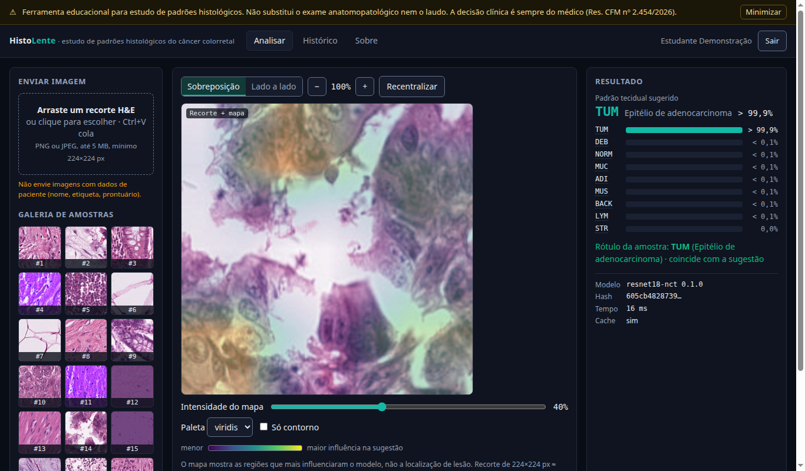
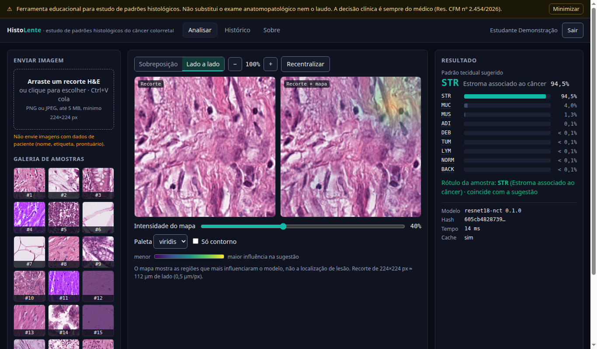
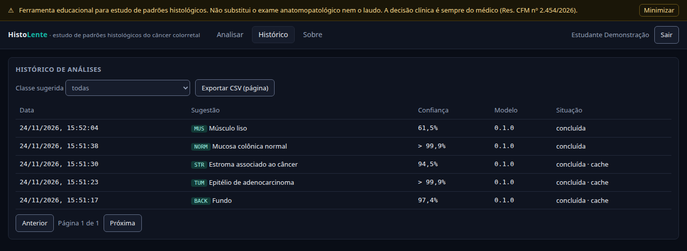
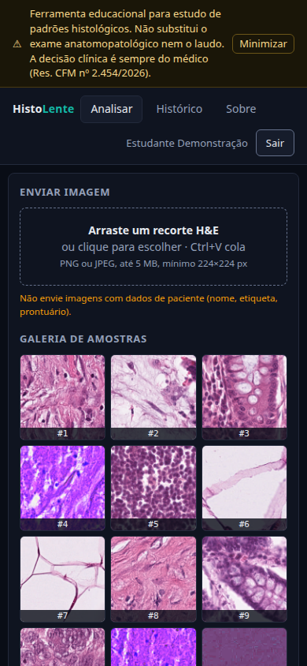

# MVP e Implantação

## 1. Escopo do MVP

O MVP cobre o fluxo central da ferramenta: o estudante entra, aceita o termo de uso, envia um recorte de lâmina (ou escolhe uma amostra da galeria) e recebe o padrão tecidual sugerido, a confiança por classe e o mapa Grad-CAM, com atualização em tempo real e histórico. Ele foi antecipado da Sprint 2 para a Sprint 1 (ata em `sprints/sprint-01.md`).

| Item do backlog | Requisito | Situação |
|---|---|---|
| EN01 — Pipeline de treino e avaliação | RNF10 | Pronto; modelo preliminar treinado (Seção 5) |
| EN02 — Docker Compose com todos os serviços | RNF03, RNF06 | Pronto |
| EN03 — Contratos das mensagens | RNF06 | Pronto |
| EN04 — Serviço de inferência | RF02, RF04, RNF01 | Pronto; falta medir o p95 no hardware de referência |
| HU14 — Autenticar-se | RF08 | Pronto |
| HU17 — Aceitar termo de uso | RF13, RNF04 | Pronto |
| HU01 — Enviar patch | RF01 | Pronto (envio individual; lote é a HU03) |
| HU19 — Acompanhar a análise em tempo real | RNF01 | Pronto (SSE) |
| HU04 — Ver resultado e confiança | RF02, RF03 | Pronto |
| HU12 — Aviso ético permanente | RF07 | Pronto |
| HU02, HU06, HU08, HU22 — galeria, baixa confiança, lado a lado, imagem fora do padrão | RF01, RF03, RF04, RF17 | Prontos (adiantados da Sprint 3 e 4) |
| HU10 — Histórico | RF05, RF06 | Parcial: filtro por classe e paginação; faltam filtros por data e lote |

## 2. Arquitetura implementada

| Contêiner | Tecnologia | Função | Redes |
|---|---|---|---|
| `web` | Next.js 14 (Node 20) | Telas, API REST, SSE, sessão, validação da imagem, recorte central, cache | frontend, backend, cache, mq |
| `consumidor` | Node 20 (mesma imagem da web) | Consome `inference.completed`, grava o resultado, preenche o cache e avisa o navegador | backend, cache, mq |
| `inference` | Python 3.12, FastAPI, PyTorch | Consome `inference.request`, classifica, gera o Grad-CAM e publica o resultado | **só mq** |
| `postgres` | PostgreSQL 16.6 | Usuários, imagens, análises, versões do modelo, consentimentos | backend |
| `redis` | Redis 7.4 | Sessões, cache por SHA-256 + versão do modelo, limite de requisições, Pub/Sub | cache |
| `rabbitmq` | RabbitMQ 3.13 | Filas `inference.request`, `inference.completed` e `inference.dlq` | mq |

O serviço de inferência não tem rota de rede nem credencial para o banco ou o Redis (RNF06), o que foi verificado dentro do contêiner e é coberto por teste de arquitetura. As decisões tomadas na implementação estão nos ADRs de `docs/adr/`.

## 3. Como executar

```
git clone https://github.com/Umizin/histolente.git && cd histolente
make app        # cria infra/.env a partir do exemplo e sobe os seis contêineres
                # aplicação em http://127.0.0.1:3000
make fumaca     # teste de fumaça ponta a ponta
make down       # derruba (os dados ficam nos volumes)
```

Sem modelo em `ml/models/`, o serviço de inferência sobe com pesos aleatórios e a interface avisa que as sugestões não têm valor.

## 4. Testes e evidências

| Camada | Testes | Onde roda |
|---|---|---|
| Banco | schema aplicado no PostgreSQL 16.6 | CI |
| Contratos | exemplos válidos e casos inválidos contra os JSON Schemas | CI |
| ML | 24 testes: divisão sem vazamento, aumentos, modelos, Grad-CAM, métricas, exportação | CI e `ml/Dockerfile` |
| Serviço de inferência | 8 testes: contrato do resultado, recorte, imagem pequena, imagem sem tecido, mensagem fora do contrato, RNF06 | CI |
| Web | verificação de tipos, testes unitários (tipo real do arquivo, ordem das classes, termos proibidos, paleta) e build | CI |
| Ambiente | 7 testes da infraestrutura (schema, Redis, filas e DLQ) | CI e `make verificar` |
| Ponta a ponta | cadastro → termo → validações → envio → evento SSE → resultado → cache → isolamento entre usuários | CI e `make fumaca` |

**Desempenho (RNF01).** 40 análises seguidas, sem cache, com o modelo 0.1.0, numa máquina de desenvolvimento com Intel Core i5-8500 (6 núcleos), sem GPU, todos os contêineres na mesma máquina:

| Medida | p50 | p95 | Meta |
|---|---|---|---|
| Serviço de inferência (recorte, classificação e Grad-CAM) | 75 ms | 108 ms | p95 < 500 ms |
| Ponta a ponta (envio até o resultado disponível) | 120 ms | 172 ms | p95 < 1,5 s |

Ainda falta a medição com 30 usuários simultâneos (EN05, k6) e no hardware de referência da demonstração.

### Telas do MVP

**Figura 1 — Resultado de uma amostra da galeria (TUM), com o mapa Grad-CAM sobreposto e o rótulo revelado depois do resultado**



Fonte: elaborado pelo autor (2026).

**Figura 2 — Modo lado a lado com zoom e deslocamento sincronizados (amostra STR)**



Fonte: elaborado pelo autor (2026).

**Figura 3 — Histórico de análises com filtro por classe e exportação CSV**



Fonte: elaborado pelo autor (2026).

**Figura 4 — Tela em celular (390 px de largura)**



Fonte: elaborado pelo autor (2026).

## 5. Modelo preliminar (versão 0.1.0)

Para o MVP funcionar com um modelo real antes do treino completo, foi treinada uma ResNet-18 pré-treinada na ImageNet, em CPU, com uma subamostra balanceada do NCT-CRC-HE-100K: 800 imagens por classe, divididas em 680 para treino e 120 para validação (semente 42; listas em `ml/splits-preliminar/`). Foram 4 épocas, em cerca de 45 minutos. A avaliação usou o CRC-VAL-HE-7K inteiro (7.180 imagens), que vem de pacientes diferentes dos do treino e não foi usado em nenhuma decisão de treino.

| Métrica (CRC-VAL-HE-7K, n = 7.180) | Valor | Meta do RNF10 |
|---|---|---|
| Acurácia | 96,6 % (IC95 96,1–97,0) | — |
| Acurácia balanceada | 95,1 % | ≥ 90 % |
| F1 macro | 95,0 % (IC95 94,4–95,6) | — |
| AUC macro (um contra todos) | 0,997 | — |
| Sensibilidade TUM | 96,4 % | ≥ 90 % |
| NORM classificado como TUM | 0,7 % (5 de 741) | ≤ 5 % |
| ECE (erro de calibração) | 0,009 | ≤ 0,05 |

Intervalos de confiança por *bootstrap* com 1.000 reamostragens. Arquivos: `ml/reports/r18-preliminar/metricas.json` e o *model card* exportado com o modelo (SHA-256 `605cb482…`).

**Figura 5 — Matriz de confusão normalizada por linha no conjunto de teste**


Fonte: elaborado pelo autor (2026), com dados de Kather et al. (2018).

O ponto fraco é o estroma (STR): só 68,9 % são reconhecidos, e 23 % vão para músculo liso (MUS). É a confusão que a interface já explica no texto de diferenças entre classes. Ela é o foco do treino completo, com o conjunto inteiro e mais épocas, no Google Colab. A acurácia de validação (98,6 %) fica acima da de teste porque treino e validação vêm das mesmas lâminas. Por isso os números que valem são os do conjunto de teste.

## 6. Implantação

Fluxo: commit → pull request → CI → merge na `main` → CD publica as imagens no GitHub Container Registry → Watchtower atualiza o servidor. Detalhes e comandos na Seção 6 de `gestao-configuracao.md`.

Endereço de demonstração: `[[A DEFINIR]]`

## 7. Limitações conhecidas

- O estado `PROCESSING` e a versão do modelo no pedido ficam para o contrato v1.1 (ADR 0004).
- Envio em lote, modo quiz, reenvio de análise com falha e Grad-CAM de outra classe estão nas sprints seguintes.
- Os textos morfológicos das classes ainda precisam da revisão de um docente de Patologia (HU05).
- O modelo preliminar não substitui o treino completo previsto; os números da Seção 5 não são o resultado final do trabalho.
