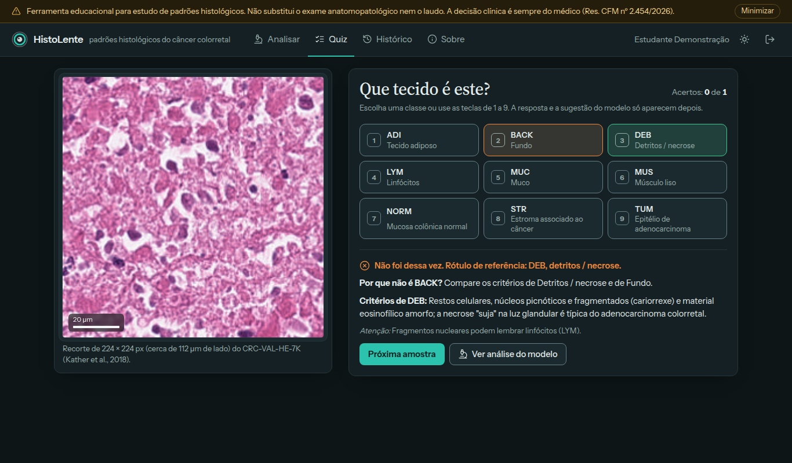
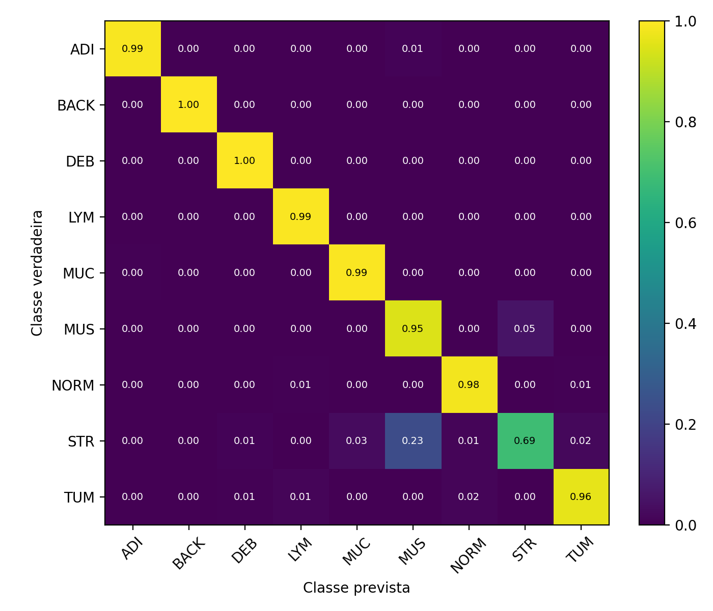
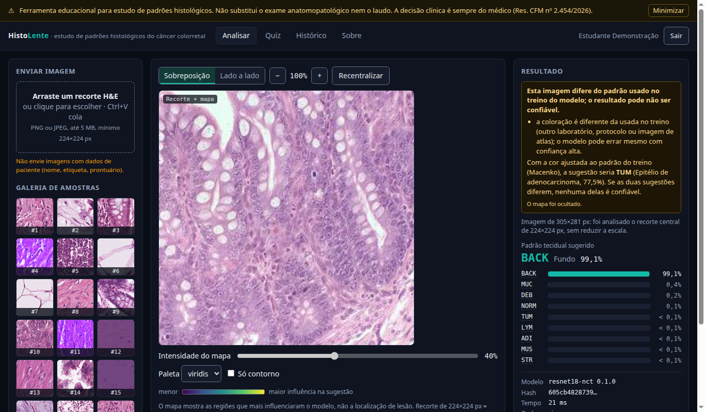

# MVP e Implantação

## 1. Escopo do MVP

O MVP cobre o fluxo central da ferramenta: o estudante entra, aceita o termo de uso, envia um recorte de lâmina (ou escolhe uma amostra da galeria) e recebe o padrão tecidual sugerido, a confiança por classe e o mapa Grad-CAM, com atualização em tempo real e histórico. Ele foi antecipado da Sprint 2 para a Sprint 1 (ata em `sprints/sprint-01.md`).

| Item do backlog | Requisito | Situação |
|---|---|---|
| EN01 — Pipeline de treino e avaliação | RNF10 | Pronto; modelo preliminar treinado (Seção 6) |
| EN02 — Docker Compose com todos os serviços | RNF03, RNF06 | Pronto |
| EN03 — Contratos das mensagens | RNF06 | Pronto |
| EN04 — Serviço de inferência | RF02, RF04, RNF01 | Pronto; falta medir o p95 no hardware de referência |
| HU14 — Autenticar-se | RF08 | Pronto |
| HU17 — Aceitar termo de uso | RF13, RNF04 | Pronto |
| HU01 — Enviar patch | RF01 | Pronto (envio individual; lote é a HU03) |
| HU19 — Acompanhar a análise em tempo real | RNF01 | Pronto (SSE) |
| HU04 — Ver resultado e confiança | RF02, RF03 | Pronto |
| HU12 — Aviso ético permanente | RF07 | Pronto |
| HU02, HU06, HU08, HU22 — galeria, baixa confiança, lado a lado, imagem fora do padrão | RF01, RF03, RF04, RF17 | Prontos (adiantados da Sprint 3 e 4) |
| HU10 — Histórico | RF05, RF06 | Parcial: filtro por classe e paginação; faltam filtros por data e lote |
| HU13 — Modo quiz | RF01, RF03 | Pronto (adiantado da Sprint 5) |
| — Alerta de coloração fora do padrão | RF17, risco R01 | Pronto (ADR 0005; Seção 6.1) |
| — "Como ler este mapa": onde está a influência e o que há na região (hematoxilina, eosina, espaço claro), medido na imagem, com os limites do Grad-CAM | RF04 | Pronto |

## 2. Arquitetura implementada

| Contêiner | Tecnologia | Função | Redes |
|---|---|---|---|
| `web` | Next.js 14 (Node 20) | Telas, API REST, SSE, sessão, validação da imagem, recorte central, cache | frontend, backend, cache, mq |
| `consumidor` | Node 20 (mesma imagem da web) | Consome `inference.completed`, grava o resultado, preenche o cache e avisa o navegador | backend, cache, mq |
| `inference` | Python 3.12, FastAPI, PyTorch | Consome `inference.request`, classifica, gera o Grad-CAM e publica o resultado | **só mq** |
| `postgres` | PostgreSQL 16.6 | Usuários, imagens, análises, versões do modelo, consentimentos | backend |
| `redis` | Redis 7.4 | Sessões, cache por SHA-256 + versão do modelo, limite de requisições, Pub/Sub | cache |
| `rabbitmq` | RabbitMQ 3.13 | Filas `inference.request`, `inference.completed` e `inference.dlq` | mq |

O serviço de inferência não tem rota de rede nem credencial para o banco ou o Redis (RNF06), o que foi verificado dentro do contêiner e é coberto por teste de arquitetura. As decisões tomadas na implementação estão nos ADRs de `docs/adr/`.

## 3. Como executar

```
git clone https://github.com/Umizin/histolente.git && cd histolente
make app        # cria infra/.env a partir do exemplo e sobe os seis contêineres
                # aplicação em http://127.0.0.1:3000
make fumaca     # teste de fumaça ponta a ponta
make down       # derruba (os dados ficam nos volumes)
```

Sem modelo em `ml/models/`, o serviço de inferência sobe com pesos aleatórios e a interface avisa que as sugestões não têm valor.

## 4. Testes e evidências

| Camada | Testes | Onde roda |
|---|---|---|
| Banco | schema aplicado no PostgreSQL 16.6 | CI |
| Contratos | exemplos válidos e casos inválidos contra os JSON Schemas | CI |
| ML | 24 testes: divisão sem vazamento, aumentos, modelos, Grad-CAM, métricas, exportação | CI e `ml/Dockerfile` |
| Serviço de inferência | 8 testes: contrato do resultado, recorte, imagem pequena, imagem sem tecido, mensagem fora do contrato, RNF06 | CI |
| Web | verificação de tipos, testes unitários (tipo real do arquivo, ordem das classes, termos proibidos, paleta) e build | CI |
| Ambiente | 7 testes da infraestrutura (schema, Redis, filas e DLQ) | CI e `make verificar` |
| Ponta a ponta | cadastro → termo → validações → envio → evento SSE → resultado → cache → isolamento entre usuários | CI e `make fumaca` |

**Desempenho (RNF01).** 40 análises seguidas, sem cache, com o modelo 0.1.0, numa máquina de desenvolvimento com Intel Core i5-8500 (6 núcleos), sem GPU, todos os contêineres na mesma máquina:

| Medida | p50 | p95 | Meta |
|---|---|---|---|
| Serviço de inferência (recorte, classificação e Grad-CAM) | 75 ms | 108 ms | p95 < 500 ms |
| Ponta a ponta (envio até o resultado disponível) | 120 ms | 172 ms | p95 < 1,5 s |

**No servidor da demonstração** (VPS de 2 vCPU e 8 GB, sem GPU), em 25/11/2026, já com a verificação de coloração da Seção 5.1: 40 imagens do CRC-VAL-HE-7K fora da galeria e do quiz, enviadas uma a uma pela internet ao endereço público, sem cache:

| Medida | p50 | p95 | Meta |
|---|---|---|---|
| Serviço de inferência | 122 ms | 154 ms | p95 < 500 ms |
| Ponta a ponta, medido do cliente pela internet | 250 ms | 297 ms | p95 < 1,5 s |

Ainda falta a medição com 30 usuários simultâneos (EN05, k6).

### Telas do MVP

**Figura 1 — Resultado de uma amostra da galeria (TUM), com o mapa Grad-CAM sobreposto e o rótulo revelado depois do resultado**


Fonte: elaborado pelo autor (2026).

**Figura 2 — Modo lado a lado com zoom e deslocamento sincronizados (amostra STR)**


Fonte: elaborado pelo autor (2026).

**Figura 3 — Histórico de análises com filtro por classe e exportação CSV**


Fonte: elaborado pelo autor (2026).

**Figura 4 — Tela em celular (390 px de largura)**


Fonte: elaborado pelo autor (2026).

**Figura 5 — Modo quiz depois de uma resposta errada: rótulo de referência, "por que não é" e critérios da classe**



Fonte: elaborado pelo autor (2026), com imagem de Kather et al. (2018).

## 5. Qualidade do código

O código segue as convenções do projeto (`CLAUDE.md`, Seção 4): TypeScript estrito (`strict` e `noUncheckedIndexedAccess`), Python com *type hints*, validação de toda entrada externa na fronteira (Zod nas rotas da API, JSON Schema e validação explícita nas mensagens), configuração só por variáveis de ambiente validadas no início e nenhum segredo no repositório.

**Organização (separação de responsabilidades).** Cada serviço separa domínio, aplicação e infraestrutura, e as dependências apontam para dentro:

| Serviço | Domínio e regras (sem E/S) | Infraestrutura (E/S) | Interface |
|---|---|---|---|
| Web e orquestração | `lib/classes.ts` (classes, critérios, limiares), `lib/imagem.ts` (tipo real do arquivo, recorte), `lib/leitura-mapa.ts`, `lib/formato.ts` | `lib/infra.ts` (PostgreSQL, Redis, RabbitMQ), `lib/armazenamento.ts`, `consumer.mjs` | rotas em `app/api/`, telas em `app/` e `components/` |
| Inferência | `histolente_ml` (pré-processamento, Grad-CAM, cor e leitura do mapa, compartilhados com o treino) e `app/modelo.py` | `app/consumidor.py` (AMQP) | `app/main.py` (saúde, prontidão, versão do modelo) |

O pré-processamento é um só, no pacote `histolente_ml`, usado pelo treino e pelo serviço: não existem duas versões que possam divergir.

**SOLID, onde se aplica:**
- *Responsabilidade única:* funções pequenas e puras para regras testáveis (`tipoReal`, `pct`, `onde`/`conteudo` da leitura do mapa, `estimar_manchas`, `resumir_mapa`); o componente `Escala` só desenha a barra de escala.
- *Inversão de dependência:* o `Consumidor` recebe o `Classificador` pelo construtor e não sabe como o modelo funciona; o `Classificador` não conhece filas. Os testes do serviço usam o classificador sem RabbitMQ.
- *Aberto/fechado:* backbones novos entram no registro `BACKBONES` (`histolente_ml/modelos.py`) sem mudar quem cria o modelo; motivos de alerta e paletas são tabelas, não condicionais espalhadas.

**Padrões de projeto e de integração:**

| Padrão | Onde |
|---|---|
| Fábrica (*Factory*) | `criar(backbone)` em `histolente_ml/modelos.py` |
| Estratégia (*Strategy*) | paleta do mapa escolhida em `colorir` (`lib/cores.ts`) |
| Adaptador (*Adapter*) | `lib/infra.ts` isola os clientes de banco, cache e fila; instâncias únicas por processo |
| Observador (*Observer*) | ganchos do PyTorch no Grad-CAM (`gradcam.py`); SSE no navegador |
| *Publish/Subscribe* | canal Redis `user:{id}` avisa o navegador do resultado |
| *Message Queue* e *Dead Letter Channel* | filas `inference.request` e `inference.completed`; mensagens inválidas ou com 3 falhas vão para `inference.dlq` |
| Receptor idempotente | o consumidor ignora `job_id` repetido (atualização condicional ao estado `QUEUED`) |
| *Cache-Aside* | resultado em cache por SHA-256 da imagem + versão do modelo + versão do pré-processamento |

**Clean Code:** nomes do domínio em português (`Classificador`, `recorte_central`, `fora_do_padrao`); limiares como constantes nomeadas (`LIMIAR_BAIXA_CONFIANCA`, `LIMIAR_TECIDO`, `MAX_BYTES`); erros tratados na fronteira com mensagem para o usuário; comentários só onde explicam o porquê. As decisões de arquitetura ficam em ADRs (`docs/adr/0001` a `0006`).

**Testes:** 88 testes automatizados (22 de contrato, 36 de ML, 9 do serviço de inferência, 14 da web, 7 do ambiente) e o teste de fumaça de ponta a ponta, todos na CI.

**O que ainda não segue o padrão** (dívida técnica registrada):
- `components/Workstation.tsx` tem cerca de 320 linhas e junta envio, visualizador e resultado; o próximo passo é dividi-lo em componentes menores.
- A rota `POST /api/analyses` concentra validação, cache, persistência e publicação; a lógica pode ir para um caso de uso separado.
- Os tipos Zod e Pydantic ainda não são gerados a partir dos JSON Schemas (EN04).
- *Lint* (ESLint e ruff) e `mypy --strict` ainda não rodam na CI.

## 6. Modelo preliminar (versão 0.1.0)

Para o MVP funcionar com um modelo real antes do treino completo, foi treinada uma ResNet-18 pré-treinada na ImageNet, em CPU, com uma subamostra balanceada do NCT-CRC-HE-100K: 800 imagens por classe, divididas em 680 para treino e 120 para validação (semente 42; listas em `ml/splits-preliminar/`). Foram 4 épocas, em cerca de 45 minutos. A avaliação usou o CRC-VAL-HE-7K inteiro (7.180 imagens), que vem de pacientes diferentes dos do treino e não foi usado em nenhuma decisão de treino.

| Métrica (CRC-VAL-HE-7K, n = 7.180) | Valor | Meta do RNF10 |
|---|---|---|
| Acurácia | 96,6 % (IC95 96,1–97,0) | — |
| Acurácia balanceada | 95,1 % | ≥ 90 % |
| F1 macro | 95,0 % (IC95 94,4–95,6) | — |
| AUC macro (um contra todos) | 0,997 | — |
| Sensibilidade TUM | 96,4 % | ≥ 90 % |
| NORM classificado como TUM | 0,7 % (5 de 741) | ≤ 5 % |
| ECE (erro de calibração) | 0,009 | ≤ 0,05 |

Intervalos de confiança por *bootstrap* com 1.000 reamostragens. Arquivos: `ml/reports/r18-preliminar/metricas.json` e o *model card* exportado com o modelo (SHA-256 `605cb482…`).

**Figura 6 — Matriz de confusão normalizada por linha no conjunto de teste**



Fonte: elaborado pelo autor (2026), com dados de Kather et al. (2018).

O ponto fraco é o estroma (STR): só 68,9 % são reconhecidos, e 23 % vão para músculo liso (MUS). É a confusão que a interface já explica no texto de diferenças entre classes. Ela é o foco do treino completo, com o conjunto inteiro e mais épocas, no Google Colab. A acurácia de validação (98,6 %) fica acima da de teste porque treino e validação vêm das mesmas lâminas. Por isso os números que valem são os do conjunto de teste.

### 6.1 Imagens com outra coloração

No primeiro teste da demonstração, um recorte de mucosa colônica tirado de um atlas, mais pálido e lilás que as imagens do dataset, recebeu a sugestão BACK com 99,1 %, e o alerta de imagem fora do padrão não disparou, porque havia bastante tecido e a confiança era alta. O experimento com essa imagem mostrou que a causa é a coloração, não a escala. O NCT-CRC-HE-100K foi todo normalizado pelo método de Macenko, e o modelo nunca viu uma coloração assim.

Três políticas foram comparadas no CRC-VAL-HE-7K (ADR 0005):

| Política | Acurácia | Acurácia balanceada | Acerto DEB | Acerto MUS |
|---|---|---|---|---|
| Sem normalização | 96,6 % | 95,1 % | 100 % | 94,6 % |
| Normalizar todas as imagens | 93,2 % | 89,6 % | 76,4 % | 70,9 % |
| Normalizar só com coloração fora do padrão | 94,6 % | 91,4 % | 76,4 % | 86,3 % |

Normalizar piorou o modelo nas imagens do próprio dataset. Por isso, a decisão foi **não trocar o resultado**: a sugestão continua sendo a da imagem original, e a coloração é verificada à parte. Quando os vetores de hematoxilina e eosina da imagem se afastam dos de treino mais do que o limite observado no treino para a classe sugerida, a análise recebe o alerta de coloração, e a tela mostra também a sugestão para a imagem com a cor ajustada (Figura 7). No caso do atlas, a sugestão original é BACK e a da cor ajustada é TUM; quando as duas diferem, a tela avisa que nenhuma é confiável.

Com essa regra, as métricas da Seção 6 não mudam, porque o resultado é o da imagem original. No CRC-VAL-HE-7K, o alerta aparece em 4,6 % das imagens (331 de 7.180), 117 delas DEB, cuja coloração no conjunto de teste difere da do treino. Nas imagens marcadas, a sugestão original acerta 89,1 % (contra 96,6 % no conjunto todo) e a da cor ajustada só 46,5 %. O alerta aponta imagens mais difíceis; a sugestão com a cor ajustada serve para mostrar ao estudante que a cor influencia o modelo, não como resposta melhor.

**Figura 7 — Recorte de atlas com coloração fora do padrão: alerta e sugestão com a cor ajustada**



Fonte: elaborado pelo autor (2026).

## 7. Implantação

A aplicação está publicada em **https://189-24-15-186.sslip.io**. O servidor, o pipeline e o processo de atualização estão no capítulo "Integração e entrega contínuas (CI/CD) e deploy".

## 8. Limitações conhecidas

- O estado `PROCESSING` e a versão do modelo no pedido ficam para o contrato v1.1 (ADR 0004).
- Envio em lote, modo quiz, reenvio de análise com falha e Grad-CAM de outra classe estão nas sprints seguintes.
- Os textos morfológicos das classes ainda precisam da revisão de um docente de Patologia (HU05).
- O modelo preliminar não substitui o treino completo previsto; os números da Seção 6 não são o resultado final do trabalho.
- O modelo é sensível à coloração (Seção 6.1). O alerta reduz o risco, mas não o elimina: imagens de outros laboratórios e de atlas podem receber sugestões erradas com confiança alta. O treino completo vai incluir aumento de dados de cor.
- Adenoma e displasia não são classes do dataset; podem aparecer como NORM ou TUM.
