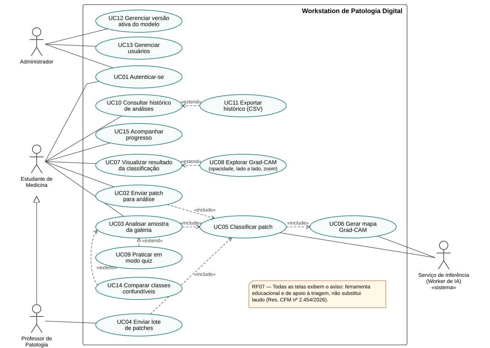

# 3 Levantamento e Análise de Requisitos

## 3.1 Método de levantamento

Sommerville (2019) observa que nenhuma técnica de elicitação, isoladamente, é capaz de revelar todos os requisitos de um sistema, recomendando a combinação de abordagens complementares. Seguindo essa orientação, o levantamento de requisitos deste trabalho estrutura-se em quatro frentes. A primeira é a análise documental e a revisão da literatura técnico-científica sobre patologia computacional. A segunda é a análise da estrutura e das classes de rotulagem do *dataset* público NCT-CRC-HE-100K, que definem os requisitos funcionais centrais de classificação do artefato. A terceira é a análise das normas aplicáveis, notadamente a Resolução CFM nº 2.454/2026 e a LGPD. A quarta é a consulta direta a usuários potenciais, por meio de entrevista estruturada escrita aplicada remotamente.

As técnicas documentais definiram o núcleo do problema e as restrições regulatórias. Sessões de ideação conduzidas pelo autor geraram hipóteses de funcionalidades pedagógicas. A consulta aos usuários tem a função de confirmar ou descartar essas hipóteses e de fundamentar a priorização dos requisitos. O Quadro 1 sintetiza as técnicas, seu estado de aplicação e os requisitos que originaram.

**Quadro 1 — Técnicas de elicitação de requisitos**

| Cód. | Técnica | Estado | Fontes / participantes | Requisitos originados |
|---|---|---|---|---|
| T1 | Análise documental e revisão da literatura | Aplicada | Sommerville (2019); Pressman e Maxim (2016); Litjens et al. (2017); Niazi, Parwani e Gurcan (2019); Zehra et al. (2023); Selvaraju et al. (2017); SBP (2025) | RF02, RF04, RF17, RNF01, RNF03, RNF06, RNF08 |
| T2 | Análise do *dataset* público | Aplicada | NCT-CRC-HE-100K (KATHER et al., 2018) | RF01, RF02, RF03 |
| T3 | Análise de normas e regulação | Aplicada | Resolução CFM nº 2.454/2026; Lei nº 13.709/2018 | RF07, RF08, RF13, RNF04, RNF07 |
| T4 | Sessões de ideação (*brainstorming*) | Aplicada | Autor | RF09, RF10, RF12, RF14, RF15, RF16, RNF09 |
| T5 | Entrevista estruturada escrita, aplicada remotamente | Aplicada (n = 4) | 3 estudantes de Medicina e 1 profissional de laboratório | Validação e priorização dos RF; RF18 |
| T7 | Observação de aula prática de Patologia | Planejada | Turma de Patologia da instituição | Validação de RF01, RF09 e RNF02 |
| T8 | Prototipação de baixa fidelidade | Planejada | Participantes de T5 e T7 | Refinamento de RF03, RF04 e RNF02 |

Fonte: elaborado pelo autor (2026). Nota: a técnica T6 (questionário separado) foi incorporada à T5, cujo quadro de funcionalidades cumpre o papel de questionário fechado.

A entrevista estruturada escrita (T5) foi aplicada por meio de formulário online, com duração estimada de dez minutos, sem gravação e sem coleta de nome ou endereço de e-mail. O formulário apresenta o TCLE em sua primeira seção e direciona cada participante, conforme o perfil declarado (estudante, professor ou profissional de laboratório), a perguntas específicas. Em seguida, todos respondem a seis perguntas abertas sobre dificuldades atuais no reconhecimento de padrões histológicos, tecidos frequentemente confundidos, uso pretendido da ferramenta, percepção sobre o mapa de calor, origem das imagens disponíveis e condições para confiar na ferramenta. Por fim, classificam seis funcionalidades candidatas como essenciais, úteis ou dispensáveis. O instrumento completo encontra-se no Apêndice D. As respostas abertas foram agrupadas por categorias temáticas, e o quadro de funcionalidades foi tabulado por frequência.

O formulário recebeu quatro respostas entre 11 e 12 de novembro de 2026, todas com aceite do TCLE: três estudantes de Medicina do 6º período, identificados como E01 a E03, e um profissional do setor de expedição de um laboratório de anatomia patológica (L01). Nenhum professor respondeu. A Tabela 1 apresenta a classificação das funcionalidades candidatas; nenhuma delas foi considerada dispensável.

**Tabela 1 — Classificação das funcionalidades candidatas pelos participantes (n = 4)**

| Funcionalidade | Essencial | Útil | Dispensável |
|---|---|---|---|
| Critérios morfológicos de cada classe e o que não confundir | 4 | 0 | 0 |
| Percentual de confiança das nove classes | 3 | 1 | 0 |
| Galeria com vários exemplos de cada classe | 2 | 2 | 0 |
| Histórico e acompanhamento do progresso | 2 | 2 | 0 |
| Mapa de calor com controle de transparência e comparação lado a lado | 1 | 3 | 0 |
| Modo quiz com explicação do erro | 1 | 3 | 0 |

Fonte: dados da pesquisa (2026).

A descrição dos critérios morfológicos foi a única funcionalidade considerada essencial por todos os participantes. Isso converge com a principal dificuldade relatada, a de diferenciar tecidos que "se coram de forma parecida" (E01), e com os pares de tecidos citados como mais confundidos: músculo e estroma (E02), mucosa normal e tumor (E03). Esses pares correspondem aos previstos no RF15, que foi confirmado e teve a prioridade elevada.

Quanto à origem das imagens, três dos quatro participantes enviariam fotografias do microscópio tiradas com o celular, e o laboratório de L01 não dispõe de scanner nem de câmera acoplada. Esse dado confirma o risco de diferença entre as imagens de uso e as de treinamento, discutido por Zehra et al. (2023) para contextos de poucos recursos, e elevou o RF17 (alerta de imagem fora do padrão) à prioridade máxima.

Todos os participantes consideraram que o mapa de calor ajudaria, sobretudo quando a lâmina tem qualidade ruim ou a estrutura é difícil de identificar. Entre as condições para confiar na ferramenta, foram citadas não confundir estruturas, não deixar passar um tumor evidente, não indicar região errada de lesão e responder mais rápido que um estudante. Essas condições reforçam o RNF01 e orientam a avaliação do modelo a reportar a sensibilidade da classe tumoral.

Por fim, a sugestão de apresentar imagens "erradas" para que o estudante identifique o que foge do padrão normal (E02) originou o RF18.

A amostra é pequena, de conveniência e concentrada num único período do curso, e não inclui professores. Por isso, os requisitos voltados ao professor continuam sem validação direta e serão verificados na observação de aula (T7) e com o orientador.

Não estão previstas, nesta etapa, entrevistas presenciais com patologistas em ambiente clínico real; profissionais de laboratório participam apenas da entrevista escrita. Essa restrição constitui limitação apontada como trabalho futuro.

## 3.2 Stakeholders identificados

- **Estudantes de Medicina e residentes de Patologia:** usuários potenciais diretos da ferramenta como apoio ao aprendizado.
- **Professores da disciplina de Patologia:** fonte de validação de requisitos e de relevância pedagógica da solução.
- **Profissionais de laboratórios de anatomia patológica** (patologistas, técnicos em histologia e biomédicos): fonte de informação sobre a rotina laboratorial, a variabilidade de coloração e os equipamentos de captura de imagem disponíveis.
- **Pacientes:** afetados indiretamente pelo tempo de espera até a confirmação diagnóstica.
- **Laboratórios de anatomia patológica de pequeno e médio porte:** potenciais beneficiários de uma solução de baixo custo.
- **Instituição de ensino (UVS):** beneficiária de uma ferramenta de apoio pedagógico.

## 3.3 Requisitos funcionais

Os requisitos funcionais foram priorizados pelo método MoSCoW [FONTE PENDENTE: método MoSCoW], que classifica cada requisito em quatro categorias: obrigatório para a primeira versão (*Must have*, M); importante, mas não bloqueante (*Should have*, S); desejável (*Could have*, C); e fora do escopo desta versão (*Won't have*). Os requisitos RF01 a RF07 provêm do projeto inicial; os requisitos RF08 a RF18 foram incorporados durante a elicitação. As prioridades foram revisadas após a consolidação da técnica T5. Os requisitos assinalados com o símbolo † ainda não foram validados por usuários: não foram avaliados pelo formulário ou foram sugeridos por um único participante. O Quadro 2 apresenta os requisitos funcionais com seus critérios de aceite.

**Quadro 2 — Requisitos funcionais**

| ID | Requisito | Prior. | Origem | Critério de aceite |
|---|---|---|---|---|
| RF01 | O sistema deve permitir o envio de *patches* histológicos nos formatos PNG ou JPEG, individualmente, em lote ou pela galeria de amostras. | M | T2, T4 | Aceita PNG/JPEG de até 5 MB; rejeita outros formatos com mensagem explicativa; lote de até 50 imagens; galeria com várias amostras por classe, analisadas com um clique. |
| RF02 | O sistema deve classificar a imagem em uma das nove classes do NCT-CRC-HE-100K (ADI, BACK, DEB, LYM, MUC, MUS, NORM, STR, TUM). | M | T1, T2 | A classe sugerida pertence sempre ao conjunto das nove classes; as amostras de referência da galeria são classificadas corretamente. |
| RF03 | O sistema deve exibir o nível de confiança de cada uma das nove classes, com descrição morfológica de cada classe. | M | T2, T4 | Exibe nove valores que somam 100% (± 0,1 p.p.), ordenados; cada classe dispõe de descrição dos critérios morfológicos. |
| RF04 | O sistema deve gerar e exibir o mapa de calor Grad-CAM sobreposto ao *patch*, com controle de opacidade e modo lado a lado. | M | T1 | Mapa de 224 × 224 px alinhado ao *patch*; opacidade ajustável de 0% a 100%; modo lado a lado com zoom e deslocamento sincronizados. |
| RF05 | O sistema deve armazenar o histórico das imagens processadas e seus resultados, incluindo a versão do modelo utilizada. | M | T1 | Cada análise registra probabilidades, mapa, versão do modelo, data e tempos de processamento. |
| RF06 | O sistema deve permitir ao usuário consultar e reabrir suas análises anteriores. | S | T1 | Lista paginada com filtros por classe, data e lote; reabrir uma análise reproduz a mesma visualização. |
| RF07 | O sistema deve exibir, em todas as telas, aviso de que os resultados têm caráter educacional e de apoio à triagem e não substituem laudo médico. | M | T3 | Aviso presente em todas as telas autenticadas; pode ser minimizado, mas não removido. |
| RF08 | O sistema deve autenticar usuários e controlar o acesso conforme o perfil (Estudante, Professor, Administrador). | M | T3 | Rotas protegidas exigem autenticação; cada perfil acessa apenas as funções permitidas. |
| RF09 | O sistema deve oferecer modo quiz, no qual o estudante escolhe a classe da amostra antes de ver a sugestão do modelo e recebe explicação em caso de erro. | S | T4, T5 | A resposta correta só aparece após a escolha; em caso de erro, são exibidos os critérios que diferenciam a classe escolhida da correta. |
| RF10 † | O sistema deve permitir exportar o histórico de análises em formato CSV. | C | T4 | O arquivo contém data, classe sugerida, confiança e versão do modelo de cada análise filtrada. |
| RF11 | O sistema deve exibir a versão do modelo em uso e suas limitações conhecidas. | S | T3, T4 | Tela informativa com versão, data de treino, métricas de teste e limitações. |
| RF12 † | O sistema deve permitir ao Administrador definir a versão ativa do modelo de classificação. | C | T4 | A troca de versão não exige recompilar o backend; novas análises registram a nova versão. |
| RF13 | O sistema deve registrar o aceite do termo de uso, e do TCLE para participantes da pesquisa, antes do primeiro uso. | S | T3 | Sem aceite registrado, a análise não é liberada; o aceite guarda versão do termo e data. |
| RF14 | O sistema deve informar falhas no processamento e permitir o reenvio da análise. | S | T4 | Em caso de falha, o usuário recebe mensagem clara e opção de reenvio, sem perder a imagem enviada. |
| RF15 | O sistema deve permitir comparar, lado a lado, amostras de duas classes frequentemente confundidas. | S | T4, T5 | O usuário escolhe um par de classes (ex.: STR × MUS) e visualiza amostras e critérios diferenciais. |
| RF16 | O sistema deve exibir ao estudante seu desempenho no modo quiz, por classe e ao longo do tempo. | C | T4, T5 | Percentual de acertos por classe e evolução por sessão, visíveis apenas ao próprio estudante. |
| RF17 | O sistema deve alertar quando a imagem enviada parecer fora do padrão do *dataset* de treino (ex.: fotografia de celular, coloração diferente de H&E, ausência de tecido). | M | T1, T5 | Antes de exibir a classificação, apresenta aviso de que o resultado pode não ser confiável. |
| RF18 † | O sistema deve oferecer um desafio em que o estudante aponta, num conjunto de amostras, a que foge do padrão. | C | T5 | Grade com 4 a 6 amostras, uma de classe diferente; a resposta só aparece após a escolha. |

Fonte: elaborado pelo autor (2026).

Foram declarados fora do escopo desta versão (*Won't have*):
- a análise de lâmina completa (*whole-slide imaging*);
- a emissão de diagnóstico ou laudo, vedada pela Resolução CFM nº 2.454/2026;
- a integração com prontuário eletrônico ou sistema de informação laboratorial;
- o uso de imagens de pacientes identificáveis;
- o aplicativo móvel nativo;
- o retreinamento do modelo pelo usuário final;
- a identificação ou segmentação de estruturas individuais, uma vez que o Grad-CAM indica regiões de influência na decisão, e não rótulos de estruturas;
- o reconhecimento de tecidos fora das nove classes do *dataset*.

## 3.4 Requisitos não funcionais

Os requisitos não funcionais foram organizados segundo as características de qualidade da ISO/IEC 25010 (INTERNATIONAL ORGANIZATION FOR STANDARDIZATION, 2011). Em relação ao projeto inicial, foram atribuídas métricas verificáveis aos requisitos RNF01 a RNF06 e acrescentados os requisitos RNF07 (segurança), RNF08 (compatibilidade) e RNF09 (escalabilidade), conforme o Quadro 3.

**Quadro 3 — Requisitos não funcionais**

| ID | Característica | Requisito | Métrica / critério | Verificação |
|---|---|---|---|---|
| RNF01 | Desempenho | O sistema deve retornar a classificação e o Grad-CAM em tempo compatível com uso interativo. | Serviço de inferência: p95 < 500 ms; do envio até o resultado na tela: p95 < 1,5 s (*patch* isolado); resultado em cache: p95 < 150 ms. | Tempos registrados por análise; teste de carga com hardware declarado. |
| RNF02 | Usabilidade | A interface deve ser utilizável por pessoas sem conhecimento técnico em IA. | SUS médio ≥ 85 (meta), mínimo aceitável 68; ≥ 90% dos participantes concluem a tarefa principal sem ajuda. | Questionário SUS e teste de tarefas. |
| RNF03 | Portabilidade | O sistema deve executar em ambiente containerizado. | O ambiente completo é iniciado com um único comando em menos de 10 min numa máquina limpa, com ou sem GPU. | Checklist em máquina limpa. |
| RNF04 | Segurança (privacidade) | Os dados de participantes devem ser tratados conforme a LGPD. | Nenhum dado de paciente; participantes pseudonimizados; aceite do TCLE registrado; registros de log sem e-mail nem imagem. | Revisão do banco de dados; teste automatizado dos logs. |
| RNF05 | Disponibilidade | O sistema deve permanecer estável durante aulas e demonstrações. | ≥ 99% de requisições bem-sucedidas em sessão de 60 min; reinício automático de serviços; nenhuma análise perdida em falha. | Teste de longa duração; verificação de saúde dos serviços. |
| RNF06 | Manutenibilidade | O serviço de IA deve ser separado do backend, com versionamento independente do modelo. | O serviço de IA não acessa o banco de dados e comunica-se apenas por fila de mensagens; troca de modelo sem recompilar o backend; cobertura de testes ≥ 70%. | Teste de arquitetura; integração contínua. |
| RNF07 | Segurança | O sistema deve proteger contas, sessões e entradas. | Senhas com *hash* Argon2 ou bcrypt; sessão em *cookie* protegido; HTTPS fora do ambiente local; validação do tipo real do arquivo; limite de requisições por usuário. | Testes de integração; checklist OWASP Top 10. |
| RNF08 | Compatibilidade | A interface deve funcionar nos equipamentos dos laboratórios de informática. | Versões recentes de Chrome, Edge e Firefox; resolução mínima 1366 × 768; tema claro legível em projetor; serviço de IA funcional apenas com CPU. | Testes automatizados em vários navegadores; teste em máquina do laboratório. |
| RNF09 | Escalabilidade | O sistema deve absorver picos de uso simultâneo em aula sem esgotar a memória. | 30 usuários simultâneos sem erro; o número de instâncias do serviço de IA pode ser aumentado sem alteração de código. | Teste de carga com uma e com duas instâncias. |

Fonte: elaborado pelo autor (2026).

Os requisitos são complementados por regras de negócio que restringem o comportamento do sistema, apresentadas no Quadro 4.

**Quadro 4 — Regras de negócio**

| ID | Regra |
|---|---|
| RN01 | Formatos aceitos: PNG e JPEG, até 5 MB; imagens com dimensões diferentes de 224 × 224 px são redimensionadas, com aviso ao usuário. |
| RN02 | Um lote contém no máximo 50 imagens. |
| RN03 | Um resultado é de baixa confiança quando a classe principal tem menos de 60% ou quando a diferença entre as duas primeiras classes é inferior a 15 p.p.; nesses casos, a interface exibe alerta. |
| RN04 | A interface nunca utiliza os termos "diagnóstico", "laudo" ou "confirmado" para descrever a saída do sistema. |
| RN05 | Uma imagem idêntica, analisada pela mesma versão do modelo, reaproveita o resultado anterior (cache indexado pelo *hash* SHA-256 da imagem e pela versão do modelo). |
| RN06 | O Estudante acessa apenas o próprio histórico. |
| RN07 | No modo quiz, o rótulo verdadeiro só aparece após a resposta do estudante. |

Fonte: elaborado pelo autor (2026).

## 3.5 Histórias de usuário e *Product Backlog*

Para orientar o desenvolvimento em *sprints* do Scrum, os requisitos foram desdobrados em histórias de usuário no formato "Como [papel], quero [funcionalidade], para [benefício]" (COHN, 2004), agrupadas em seis épicos: análise de imagens, explicabilidade visual, apoio pedagógico, histórico e rastreabilidade, acesso e conformidade, e administração do modelo. Os critérios de aceitação das histórias principais foram descritos em cenários na notação Gherkin (Dado / Quando / Então), o que permite convertê-los diretamente em testes automatizados.

O *Product Backlog* inicial reúne 23 histórias de usuário e 6 itens habilitadores técnicos, como o pipeline de treinamento do modelo, o ambiente Docker Compose e o contrato de mensagens entre os serviços. Esses itens somam 138 pontos de história, distribuídos em seis *sprints* de duas semanas. A ordem do backlog prioriza, nas duas primeiras *sprints*, a infraestrutura e o fluxo central de envio, classificação e exibição do resultado. Os itens de prioridade *Could have* ficam para a última *sprint*. As histórias completas, os cenários Gherkin e o backlog encontram-se no Apêndice A.

## 3.6 Modelagem de casos de uso

A ferramenta desenvolvida neste trabalho foi denominada **HistoLente**. O nome remete à ideia de uma lente de estudo, que auxilia a observação da lâmina sem substituir o olhar do especialista. A Figura 1 apresenta o diagrama de casos de uso da UML, com quatro atores e quinze casos de uso. O Professor é modelado como especialização do Estudante, herdando seus casos de uso e acrescentando o envio de lotes para aulas práticas. O Serviço de Inferência aparece como ator secundário de sistema, refletindo seu isolamento arquitetural (RNF06). Os casos de uso de envio (UC02, UC03 e UC04) incluem a classificação (UC05), que por sua vez inclui a geração do mapa Grad-CAM (UC06). Funcionalidades opcionais, como a exploração do mapa, o modo quiz, a comparação de classes e a exportação do histórico, são modeladas como extensões.

**Figura 1 — Diagrama de casos de uso da ferramenta HistoLente**

{.paisagem}

Fonte: elaborado pelo autor (2026).

Os casos de uso principais foram especificados com atores, requisitos relacionados, pré-condições, pós-condições, fluxo principal, fluxos alternativos e fluxos de exceção: UC02 (enviar *patch* para análise), UC03 (analisar amostra da galeria, com a extensão do modo quiz), UC08 (explorar mapa Grad-CAM) e UC10 (consultar histórico). As especificações completas encontram-se no Apêndice B.

## 3.7 Rastreabilidade de requisitos

Para garantir que cada requisito seja implementado e verificado, foi construída uma matriz de rastreabilidade. Ela liga cada requisito à técnica de elicitação e à lacuna do referencial teórico (Seção 1.8) que o originaram, às histórias de usuário e aos casos de uso que o realizam, aos casos de teste que o verificam e à etapa de validação correspondente (Seção 2.4). Foram especificados 40 casos de teste, de unidade, integração, ponta a ponta, carga, segurança e usabilidade.

A verificação da matriz indica que:
- todos os 18 requisitos funcionais e os 9 requisitos não funcionais possuem ao menos uma história ou item habilitador e ao menos um caso de teste;
- todos os 15 casos de uso derivam de ao menos um requisito;
- as três lacunas identificadas na Seção 1.8 estão cobertas por requisitos.

A matriz completa e a lista de casos de teste encontram-se no Apêndice C.
