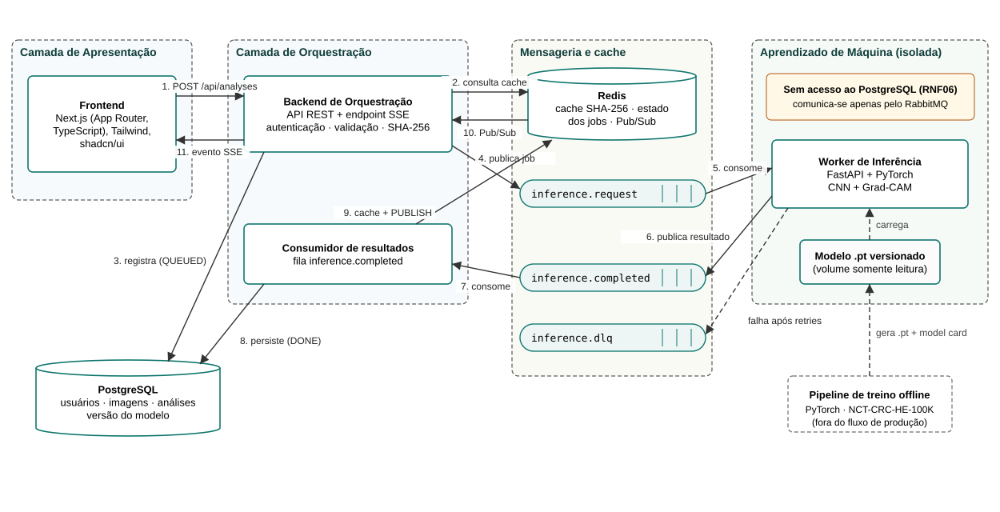

# 4 Arquitetura Conceitual da Solução

> **Nota de trabalho (18/11/2026, remover na versão final):** este capítulo ainda descreve a versão anterior do projeto. As decisões revisadas (versão do modelo no pedido, evento de início, novas tentativas por filas de espera, canal SSE por usuário, recorte central) estão em `docs/projeto/01-arquitetura.md` §1.5 e serão incorporadas aqui junto com a implementação da Sprint 2.

## 4.1 Visão geral

A arquitetura conceitual da solução foi projetada em torno da separação clara entre três domínios de responsabilidade:
- a **camada de apresentação**, responsável pela interação do usuário;
- a **camada de orquestração**, responsável por autenticação, validação, persistência e coordenação do processamento;
- a **camada de aprendizado de máquina**, responsável pela inferência do modelo e pela geração das explicações visuais.

A comunicação entre a orquestração e o aprendizado de máquina é assíncrona e orientada a eventos, intermediada por uma fila de mensagens. Essa escolha atende a três requisitos.

Ela atende ao RNF06 porque o serviço de inferência não compartilha banco de dados com o restante do sistema, o que permite versionar e substituir o modelo de forma independente. Sommerville (2019) aponta a separação de responsabilidades e o baixo acoplamento entre componentes como fatores determinantes da manutenibilidade.

Ela atende ao RNF09 porque a fila absorve picos de requisições simultâneas, como os de uma aula prática em laboratório de informática, e controla quantas imagens cada instância do serviço de inferência processa por vez. Isso evita o esgotamento de memória da GPU ou da CPU.

Ela atende ao RNF01 porque o resultado é entregue ao navegador por meio de *Server-Sent Events* (SSE), canal unidirecional no qual o servidor notifica o cliente assim que o processamento termina, sem consultas periódicas.

A Figura 2 apresenta os componentes e o fluxo numerado de uma análise.

**Figura 2 — Arquitetura conceitual da solução proposta**

{.paisagem}

Fonte: elaborado pelo autor (2026).

## 4.2 Componentes da solução

- **Frontend (Next.js):** aplicação web desenvolvida com Next.js (App Router e TypeScript), Tailwind CSS e shadcn/ui, organizada como uma estação de trabalho de tema escuro, que não compete visualmente com as cores da coloração H&E. É responsável pelo envio de imagens (individual, em lote ou pela galeria de amostras), pela exibição da classificação e das confianças por classe, pelo visualizador interativo do mapa Grad-CAM (opacidade ajustável, modo lado a lado e zoom sincronizado), pela consulta ao histórico e pelo aviso permanente exigido pela Resolução CFM nº 2.454/2026 (RF07). Recebe os resultados em tempo real por SSE.
- **Backend de orquestração (API REST e endpoint SSE):** é o único componente com acesso ao banco de dados relacional. Valida a entrada (tipo real do arquivo, dimensões e tamanho), calcula o *hash* SHA-256 da imagem e consulta o cache. Quando o resultado ainda não existe, registra a análise e publica a tarefa na fila de requisições. Também consome os resultados, persiste-os e notifica o frontend.
- **Fila de mensagens (RabbitMQ):** desacopla o recebimento da requisição do processamento de inferência por meio de duas filas duráveis: `inference.request`, com as tarefas, e `inference.completed`, com os resultados. Mensagens que falham após três tentativas são encaminhadas a uma fila de mensagens mortas (`inference.dlq`), de modo que nenhuma análise é perdida silenciosamente (RNF05).
- **Redis:** armazena em cache os resultados de inferências repetidas, indexados pelo *hash* da imagem e pela versão do modelo; mantém o estado transitório das tarefas; e fornece o mecanismo de publicação e assinatura (*Pub/Sub*) que alimenta o canal SSE.
- **Serviço de inferência (FastAPI e PyTorch):** consome as tarefas da fila, carrega o modelo de classificação treinado, executa a predição e publica o resultado na fila de resultados. O resultado contém as probabilidades das nove classes, o mapa de calor, a versão do modelo e os tempos de processamento. O serviço não possui credenciais nem rota de rede para o PostgreSQL (RNF06) e expõe apenas *endpoints* de saúde e métricas.
- **Módulo de explicabilidade (Grad-CAM):** integrado ao serviço de inferência, gera o mapa de calor que indica as regiões da imagem mais relevantes para a decisão do modelo (SELVARAJU et al., 2017).
- **PostgreSQL:** armazena usuários, metadados de imagens, histórico de análises e a versão do modelo utilizada em cada inferência, garantindo rastreabilidade (RF05).
- **Pipeline de treinamento offline (Python e PyTorch):** responsável pelo treinamento e pela geração de versões do modelo a partir do *dataset* público NCT-CRC-HE-100K (KATHER et al., 2018). É executado fora do fluxo de produção, e cada versão gerada é disponibilizada ao serviço de inferência como arquivo somente leitura.
- **Docker e Docker Compose:** orquestram todos os serviços em contêineres (RNF03), com redes segregadas que impedem o serviço de inferência de alcançar o banco de dados.

## 4.3 Fluxo de dados

O processamento de uma imagem segue a numeração da Figura 2.

O fluxo inicia-se no envio da imagem pelo usuário, que o frontend encaminha ao backend de orquestração (1). O backend valida a entrada, calcula o *hash* SHA-256 da imagem e consulta o Redis (2). Se já existir resultado para aquela imagem com a versão ativa do modelo, a análise é registrada e o resultado é devolvido imediatamente, sem novo processamento.

Caso contrário, o backend registra a análise no PostgreSQL com o estado "na fila" (3) e publica a tarefa em `inference.request` (4). Em paralelo, o frontend abre um canal SSE para acompanhar a análise. O serviço de inferência consome a tarefa (5), executa a classificação, gera o mapa Grad-CAM e publica o resultado em `inference.completed` (6). Se o processamento falhar repetidamente, a mensagem segue para a fila de mensagens mortas e o usuário é notificado da falha, com a opção de reenvio (RF14).

O backend consome o resultado (7) e o persiste no PostgreSQL, associado à versão do modelo utilizada (8). Em seguida, grava o resultado no cache e publica uma notificação no Redis (9). A notificação chega ao endpoint SSE (10), que entrega o evento de conclusão ao frontend (11). A interface então exibe a classe sugerida, as confianças e o mapa de calor interativo.

Se a conexão SSE for interrompida, o frontend reconecta-se e o backend consulta o estado atual da análise antes de voltar a aguardar notificações, evitando perda do resultado. A meta de desempenho para esse ciclo completo é de 1,5 s no percentil 95 para um *patch* isolado (RNF01).

## 4.4 Decisões arquiteturais

O Quadro 5 resume as principais decisões arquiteturais e as alternativas consideradas.

**Quadro 5 — Decisões arquiteturais**

| Decisão | Alternativas consideradas | Justificativa |
|---|---|---|
| Frontend em Next.js | Vue 3 | Ecossistema de componentes acessíveis (shadcn/ui), TypeScript estrito e possibilidade de hospedar a orquestração no mesmo projeto. |
| Persistência exclusiva no backend de orquestração | Serviço de inferência gravando diretamente no banco | Mantém o serviço de inferência sem estado e sem credenciais de banco, permitindo substituí-lo ou escalá-lo de forma independente (RNF06, RNF09). |
| Comunicação por fila de mensagens (RabbitMQ) | Chamada HTTP síncrona ao serviço de inferência | Absorve picos de uso, controla a carga sobre cada instância e permite novas tentativas sem perda de tarefas (RNF05, RNF09). |
| Entrega de resultados por SSE | Consulta periódica (*polling*); WebSocket | Comunicação unidirecional suficiente para o caso de uso, com menor latência que o *polling* e menor complexidade que o WebSocket (RNF01). |
| Cache por *hash* SHA-256 e versão do modelo | Sem cache | Evita reprocessar imagens repetidas, frequentes no uso da galeria em sala de aula; a troca de versão do modelo invalida o cache automaticamente. |
| Imagem transportada na própria mensagem | Armazenamento compartilhado entre os serviços | *Patches* de 224 × 224 px são pequenos, e o transporte na mensagem dispensa um volume compartilhado entre os domínios. |

Fonte: elaborado pelo autor (2026).
