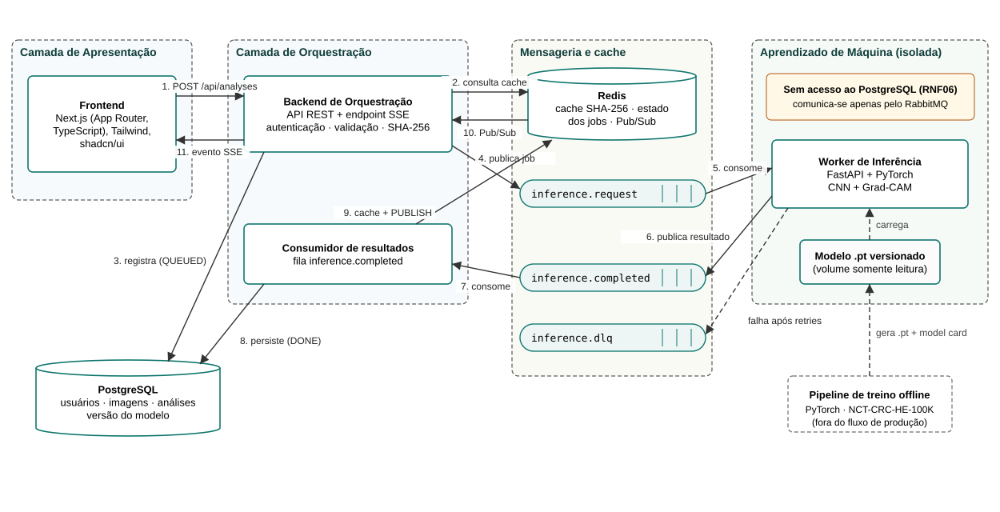

# 1. Arquitetura de Software

## 1.1 Estilo e padrões escolhidos

A solução combina **dois níveis de decisão arquitetural**:

| Nível | Estilo / padrão | Onde se aplica |
|---|---|---|
| Entre serviços (macro) | **Arquitetura orientada a eventos** com serviços independentes (microsserviços leves): frontend, backend de orquestração e serviço de inferência, comunicando-se por fila de mensagens (RabbitMQ) e Pub/Sub (Redis) | Sistema como um todo — ver Figura 2 da monografia (`docs/monografia/figuras/arquitetura.svg`) |
| Dentro de cada serviço (micro) | **Arquitetura hexagonal** (portas e adaptadores), organizada em camadas no estilo **Clean Architecture**: `domain` → `application` → `infrastructure` / `interfaces` | Backend de orquestração e serviço de inferência |
| Interface | **Componentes** React (Next.js App Router) com Server Components por padrão e componentes cliente apenas onde há interação | Frontend |

**Figura 1 — Arquitetura da solução, com o fluxo numerado de uma análise**

{.paisagem}

Fonte: elaborado pelo autor (2026).

## 1.2 Justificativa

**Por que orientada a eventos entre os serviços:**
1. **Isolamento do modelo de IA (RNF06).** O serviço de inferência só conhece o contrato da mensagem. Não acessa banco, não conhece usuários e pode ser substituído ou reescrito sem afetar o restante.
2. **Picos de uso em aula (RNF09).** A fila absorve dezenas de envios simultâneos, e o `prefetch` limita quantas imagens cada instância processa por vez, protegendo a memória da CPU ou GPU.
3. **Resiliência (RNF05).** Mensagens duráveis, confirmação manual e fila de mensagens mortas garantem que nenhuma análise se perca silenciosamente.
4. **Latência percebida baixa (RNF01).** A resposta do envio é imediata (202); o resultado chega por SSE assim que fica pronto, sem *polling*.

**Por que hexagonal / Clean Architecture dentro dos serviços:**
1. **Testabilidade.** Regras de negócio (RN01–RN07) e casos de uso são testados sem banco, fila ou rede, usando implementações falsas das portas.
2. **Troca de tecnologia sem reescrever regras.** O PostgreSQL, o Redis ou o RabbitMQ ficam atrás de interfaces (`AnaliseRepository`, `CacheResultados`, `PublicadorJobs`); trocar um adaptador não toca o domínio.
3. **SOLID na prática.**
   - Inversão de dependência: os casos de uso dependem de portas, não de implementações.
   - Responsabilidade única: cada caso de uso faz uma coisa.
   - Aberto/fechado: novos adaptadores entram sem alterar o núcleo.

**Alternativas descartadas:**

| Alternativa | Motivo da rejeição |
|---|---|
| Monólito único com inferência embutida | Acopla PyTorch ao servidor web, impede escalar a inferência separadamente e viola o RNF06 |
| MVC clássico sem portas | Mistura regras de negócio com controladores e acesso a dados, o que dificulta testar as regras de negócio |
| Microsserviços com banco por serviço e múltiplos serviços de domínio | Complexidade desproporcional para um desenvolvedor e para o escopo do MVP |
| Chamada HTTP síncrona ao serviço de inferência | Sem controle de carga nem novas tentativas; picos derrubariam o serviço (RNF05, RNF09) |

## 1.3 Organização de pastas (alvo)

```
apps/web/                         # Next.js — Apresentação (+ Orquestração via Route Handlers, ver ADR 0001)
  src/app/                        # rotas (App Router) e Route Handlers (/api/...)
  src/components/workstation/     # componentes de interface
  src/server/
    domain/                       # entidades, value objects, regras de negócio (sem I/O)
    application/                  # casos de uso + portas (interfaces)
    infrastructure/               # adaptadores: Prisma, Redis, RabbitMQ, storage
services/inference/
  app/domain/                     # classes canônicas, resultado de inferência
  app/application/                # caso de uso ProcessarJob + portas
  app/infrastructure/             # consumidor AMQP, modelo PyTorch, Grad-CAM
packages/contracts/               # JSON Schema dos eventos (fonte única TS + Python)
infra/                            # docker-compose.yml, db/schema.sql
```

## 1.4 Registro de decisões (ADR)
As decisões estão resumidas no Quadro 5 da monografia (Seção 4.4). A decisão em aberto é se a orquestração fica nos Route Handlers do Next.js ou num serviço Node separado. Proposta: **Route Handlers** no MVP (menos serviços para manter), extraindo para serviço próprio se a carga exigir. Registrar em `docs/adr/0001-orquestracao-no-nextjs.md` ao iniciar a Sprint 2.
