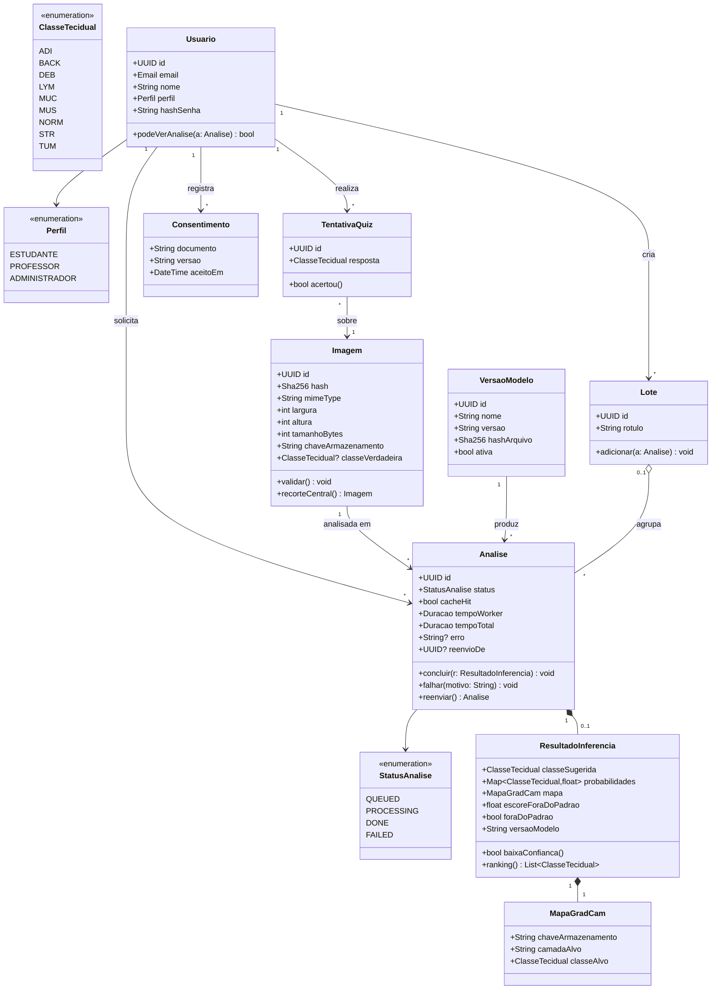
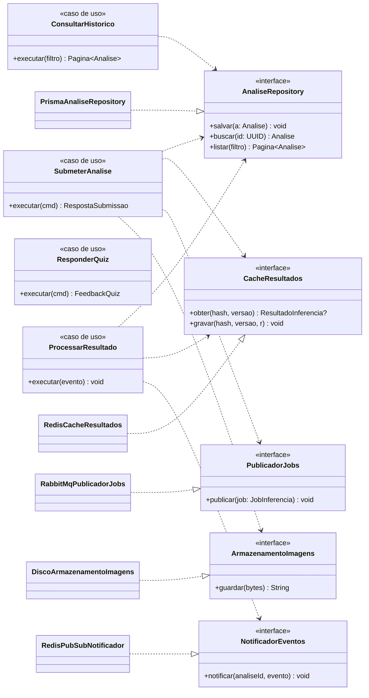
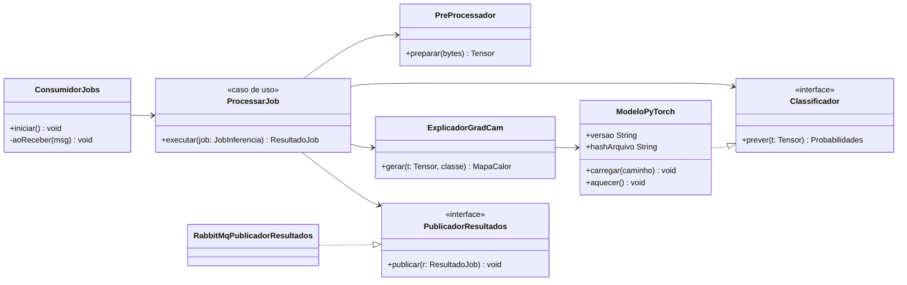
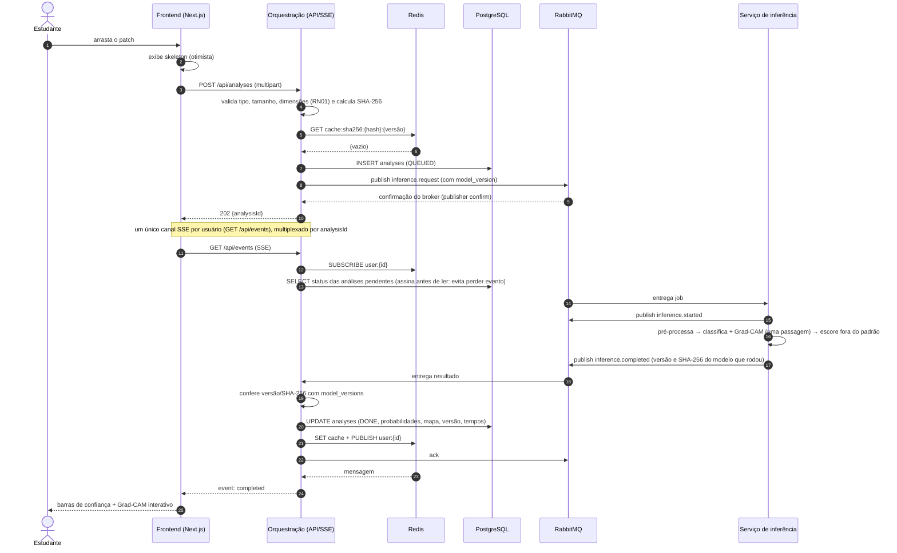
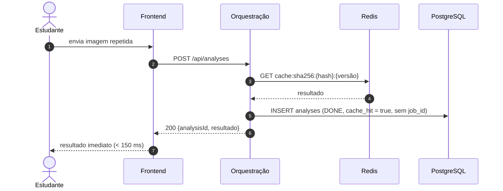
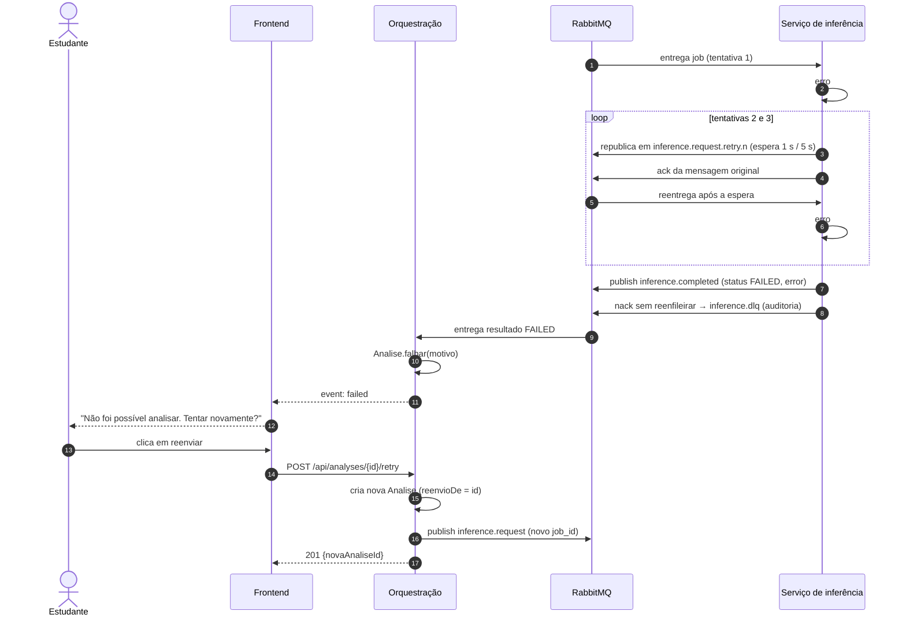
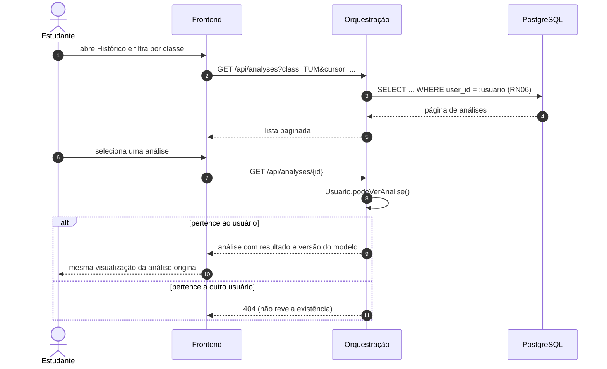
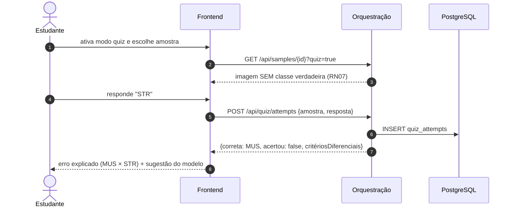

# 2. Modelagem Estrutural e Comportamental

> Revisão de 18/11/2026: os fluxos SQ1 e SQ3 e as classes de domínio foram atualizados após a revisão interna (assinatura antes da leitura no SSE, canal por usuário, versão do modelo no pedido, evento `inference.started`, novas tentativas por filas de espera). Os contratos e a topologia correspondentes serão implementados com o serviço de inferência (EN04) e o backend (HU01), na Sprint 2.
>
> Os diagramas estão em Mermaid. Eles são renderizados no GitHub e no VS Code (extensão *Markdown Preview Mermaid Support*), e as imagens usadas nos PDFs ficam em `docs/projeto/figuras/` (geradas por `tools/mermaid_svg.py`).

## 2.1 Diagrama de classes — Modelo de domínio do backend de orquestração

## 2.2 Diagrama de classes — Casos de uso, portas e adaptadores (arquitetura hexagonal)

Os casos de uso dependem apenas das portas (interfaces). As implementações concretas, os adaptadores, ficam na camada de infraestrutura e podem ser trocadas sem alterar o domínio.

Os valores de `StatusAnalise` são os mesmos do banco e do contrato de mensagens; a interface mostra rótulos em português ("na fila", "processando", "concluída", "falhou"). `reenviar()` cria uma **nova** análise ligada à original por `reenvioDe`, preservando o histórico de tentativas. A decisão de imagem fora do padrão (RF17) é produzida pelo serviço de inferência e chega no resultado; por isso pertence a `ResultadoInferencia`, e não a `Imagem`.

**Padrões de projeto aplicados:**

| Padrão | Onde | Para quê |
|---|---|---|
| Ports & Adapters, hexagonal (COCKBURN, 2005) | Portas `*Repository`, `CacheResultados`, `PublicadorJobs`; adaptadores Prisma, Redis, RabbitMQ | Isolar o domínio da infraestrutura |
| Repository (FOWLER, 2002) | `AnaliseRepository` | Abstrair a persistência |
| Command / Use Case | `SubmeterAnalise`, `ProcessarResultado`… | Uma operação de negócio por classe (responsabilidade única) |
| Value Object (EVANS, 2003) | `Sha256`, `Email`, `Duracao` | Validar na criação e evitar dados inválidos no domínio |
| Observer (GAMMA et al., 1994) / Publish-Subscribe (HOHPE; WOOLF, 2003) | `NotificadorEventos` → SSE | Notificar o navegador quando o resultado chega |
| Strategy (GAMMA et al., 1994) | Backbone da CNN e colormap do Grad-CAM (serviço de inferência) | Trocar a arquitetura do modelo ou a paleta sem alterar o fluxo |
| Idempotent Receiver (HOHPE; WOOLF, 2003) | `ProcessarResultado` (ignora `job_id` repetido) | Mensagens duplicadas não geram efeitos duplicados |

## 2.3 Diagrama de classes — Serviço de inferência

## 2.4 Diagramas de sequência dos fluxos principais

### SQ1 — Enviar *patch* (sem resultado em cache) — UC02, RF01–RF05, RNF01

### SQ2 — Enviar *patch* já analisado (resultado em cache) — RN05

### SQ3 — Falha no processamento e reenvio — RF14, RNF05

As novas tentativas são feitas por filas de espera com tempo de vida (1 s, 5 s e 25 s), que devolvem a mensagem à fila principal. Na última tentativa, o próprio serviço de inferência publica o resultado com `status: FAILED`, porque o RabbitMQ não gera eventos de domínio. Uma rotina do backend marca como falha as análises paradas há mais de 5 minutos (serviço fora do ar).

### SQ4 — Consultar e reabrir análise do histórico — UC10, RF06, RN06

### SQ5 — Praticar no modo quiz — UC09, RF09, RF16, RN07

