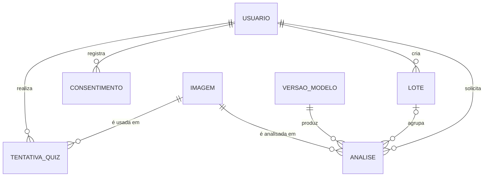
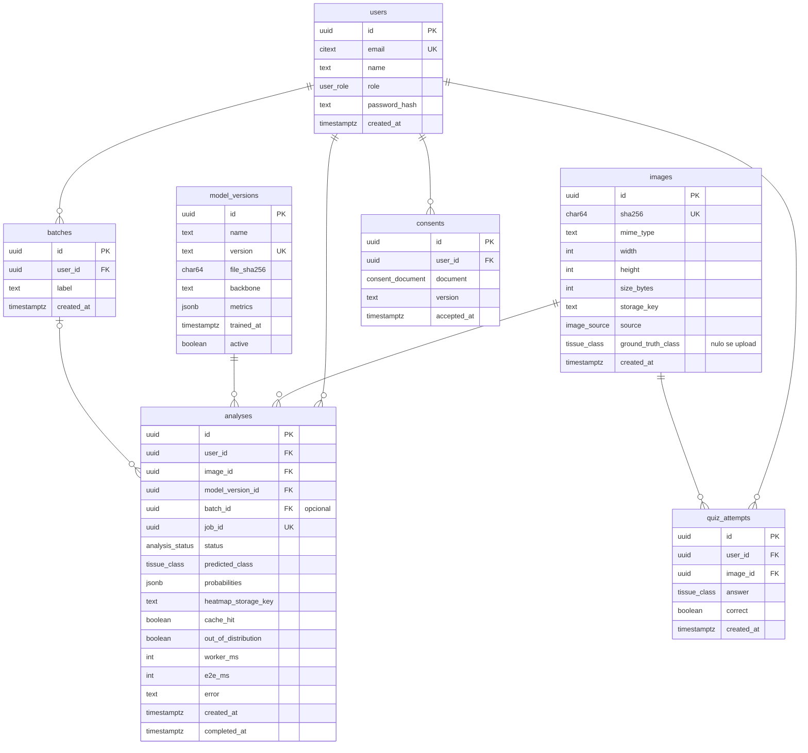

# 3. Modelagem de Dados

## 3.1 Modelo conceitual (MER)

Entidades e relacionamentos, sem detalhes de implementação.

**Regras do modelo conceitual:**
- Uma análise pertence a exatamente um usuário, uma imagem e uma versão do modelo, e opcionalmente a um lote.
- A mesma imagem (identificada pelo *hash*) pode ser analisada várias vezes, por usuários ou versões de modelo diferentes.
- Apenas imagens da galeria têm classe verdadeira e podem ser usadas no quiz.

## 3.2 Modelo lógico

**Normalização:** o modelo está na 3ª forma normal. A exceção deliberada é `analyses.probabilities` (JSONB com as 9 probabilidades): elas são sempre lidas e gravadas juntas, nunca consultadas individualmente. Separá-las em 9 linhas por análise só aumentaria o custo sem benefício.

## 3.3 Modelo físico
Implementado em PostgreSQL 16: [`infra/db/schema.sql`](../../infra/db/schema.sql). Os tipos enumerados, as restrições `CHECK`, as chaves estrangeiras e os índices estão descritos no arquivo.

## 3.4 Dicionário de dados

### `users` — usuários do sistema
| Coluna | Tipo | Nulo | Padrão | Restrições | Descrição |
|---|---|---|---|---|---|
| id | uuid | não | gen_random_uuid() | PK | Identificador |
| email | citext | não | — | UNIQUE | E-mail de login (sem diferenciar maiúsculas) |
| name | text | não | — | 1–120 caracteres | Nome exibido |
| role | user_role | não | 'STUDENT' | STUDENT, PROFESSOR, ADMIN | Perfil de acesso (RF08) |
| password_hash | text | não | — | — | *Hash* Argon2id da senha (RNF07); nunca a senha |
| created_at | timestamptz | não | now() | — | Data de cadastro |

### `model_versions` — versões do modelo de classificação
| Coluna | Tipo | Nulo | Padrão | Restrições | Descrição |
|---|---|---|---|---|---|
| id | uuid | não | gen_random_uuid() | PK | Identificador |
| name | text | não | — | — | Nome do modelo (ex.: resnet50-nct) |
| version | text | não | — | UNIQUE | Versão semântica (ex.: 1.2.0) |
| file_sha256 | char(64) | não | — | hexadecimal | *Hash* do arquivo `.pt` (rastreabilidade) |
| backbone | text | não | — | — | Arquitetura da CNN |
| metrics | jsonb | sim | — | — | Métricas no conjunto de teste (acurácia, F1 macro, AUC) |
| trained_at | timestamptz | sim | — | — | Data do treinamento |
| active | boolean | não | false | no máximo uma linha com true | Versão em uso (RF12) |

### `images` — imagens enviadas ou da galeria
| Coluna | Tipo | Nulo | Padrão | Restrições | Descrição |
|---|---|---|---|---|---|
| id | uuid | não | gen_random_uuid() | PK | Identificador |
| sha256 | char(64) | não | — | UNIQUE | *Hash* do conteúdo; base do cache (RN05) |
| mime_type | text | não | — | image/png ou image/jpeg | Tipo real do arquivo (RN01) |
| width, height | integer | não | — | > 0 | Dimensões originais em pixels |
| size_bytes | integer | não | — | 1 a 5.242.880 | Tamanho (máx. 5 MB, RN01) |
| storage_key | text | não | — | — | Caminho no armazenamento de arquivos |
| source | image_source | não | 'UPLOAD' | UPLOAD, SAMPLE_GALLERY | Origem da imagem |
| ground_truth_class | tissue_class | sim | — | obrigatório só para a galeria | Classe verdadeira (galeria e quiz) |
| created_at | timestamptz | não | now() | — | Data do primeiro envio |

### `batches` — lotes de imagens (aulas)
| Coluna | Tipo | Nulo | Padrão | Restrições | Descrição |
|---|---|---|---|---|---|
| id | uuid | não | gen_random_uuid() | PK | Identificador |
| user_id | uuid | não | — | FK users | Professor que criou o lote |
| label | text | não | — | 1–120 caracteres | Nome do lote (ex.: "Aula 3 — estroma × músculo") |
| created_at | timestamptz | não | now() | — | Data de criação |

### `analyses` — análises (histórico, RF05)
| Coluna | Tipo | Nulo | Padrão | Restrições | Descrição |
|---|---|---|---|---|---|
| id | uuid | não | gen_random_uuid() | PK | Identificador |
| user_id | uuid | não | — | FK users | Quem solicitou |
| image_id | uuid | não | — | FK images | Imagem analisada |
| model_version_id | uuid | não | — | FK model_versions | Versão do modelo usada |
| batch_id | uuid | sim | — | FK batches | Lote, se houver |
| job_id | uuid | não | — | UNIQUE | Identificador da mensagem (idempotência) |
| status | analysis_status | não | 'QUEUED' | QUEUED, PROCESSING, DONE, FAILED | Estado do processamento |
| predicted_class | tissue_class | sim | — | obrigatório se DONE | Classe sugerida |
| probabilities | jsonb | sim | — | 9 chaves, soma ≈ 1 | Probabilidade por classe (RF03) |
| heatmap_storage_key | text | sim | — | — | Caminho do mapa Grad-CAM (RF04) |
| cache_hit | boolean | não | false | — | Resultado reaproveitado do cache |
| out_of_distribution | boolean | não | false | — | Imagem fora do padrão (RF17) |
| worker_ms | integer | sim | — | ≥ 0 | Tempo no serviço de inferência (RNF01) |
| e2e_ms | integer | sim | — | ≥ 0 | Tempo do envio ao resultado (RNF01) |
| error | text | sim | — | — | Motivo da falha (RF14) |
| created_at | timestamptz | não | now() | — | Data do envio |
| completed_at | timestamptz | sim | — | — | Data de conclusão |

### `consents` — aceites de termos (RF13, RNF04)
| Coluna | Tipo | Nulo | Padrão | Restrições | Descrição |
|---|---|---|---|---|---|
| id | uuid | não | gen_random_uuid() | PK | Identificador |
| user_id | uuid | não | — | FK users | Quem aceitou |
| document | consent_document | não | — | TERMS, TCLE | Documento aceito |
| version | text | não | — | — | Versão do documento |
| accepted_at | timestamptz | não | now() | — | Data e hora do aceite |

### `quiz_attempts` — respostas do modo quiz (RF09, RF16)
| Coluna | Tipo | Nulo | Padrão | Restrições | Descrição |
|---|---|---|---|---|---|
| id | uuid | não | gen_random_uuid() | PK | Identificador |
| user_id | uuid | não | — | FK users | Estudante |
| image_id | uuid | não | — | FK images (galeria) | Amostra usada |
| answer | tissue_class | não | — | — | Classe escolhida |
| correct | boolean | não | — | — | Acertou? |
| created_at | timestamptz | não | now() | — | Data da tentativa |

### Tipos enumerados
| Tipo | Valores |
|---|---|
| tissue_class | ADI, BACK, DEB, LYM, MUC, MUS, NORM, STR, TUM (ordem canônica do modelo) |
| user_role | STUDENT, PROFESSOR, ADMIN |
| analysis_status | QUEUED, PROCESSING, DONE, FAILED |
| image_source | UPLOAD, SAMPLE_GALLERY |
| consent_document | TERMS, TCLE |

### Dados fora do PostgreSQL
| Dado | Onde | Retenção |
|---|---|---|
| Arquivos de imagem e mapas Grad-CAM | Volume de armazenamento (`storage_key`) | Enquanto houver análise associada |
| Cache de resultados | Redis `cache:sha256:{hash}:{versão}` | 7 dias |
| Estado transitório dos jobs | Redis `job:{id}` | 1 hora |
| Modelos `.pt` | Volume somente leitura | Permanente, versionado |
