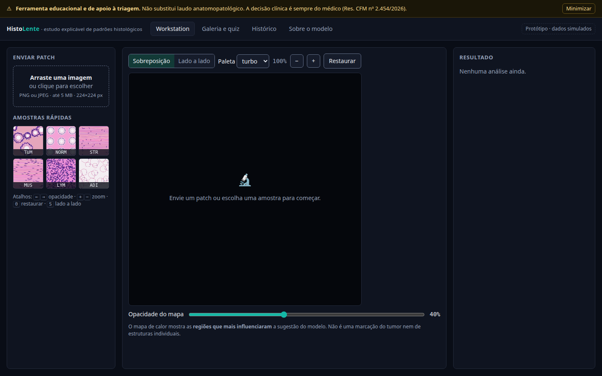
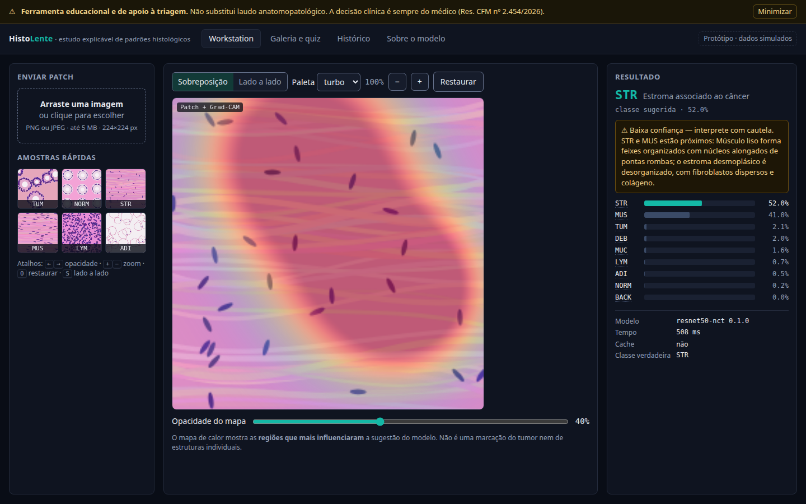
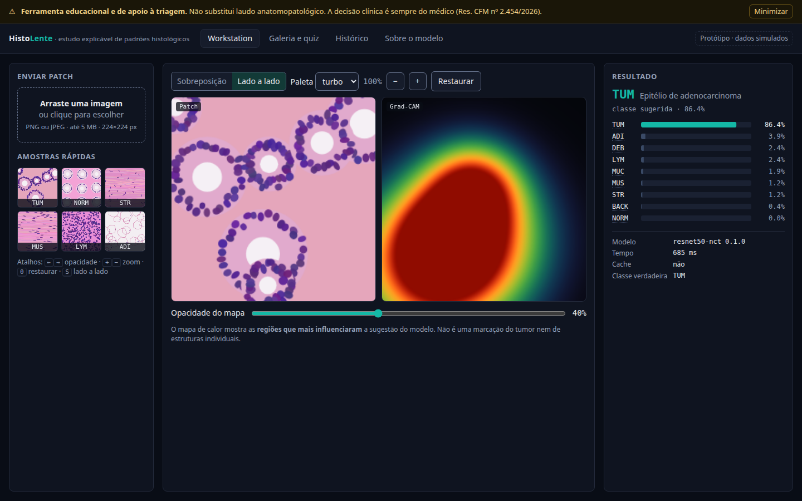
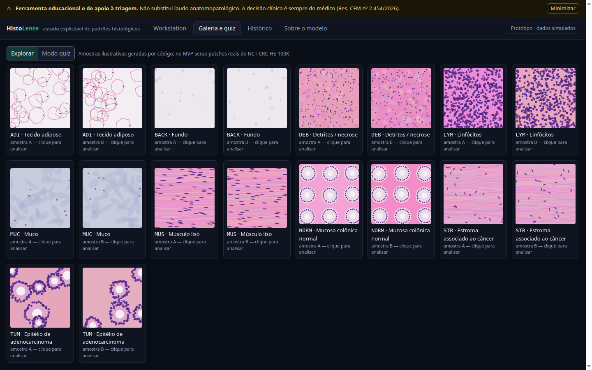
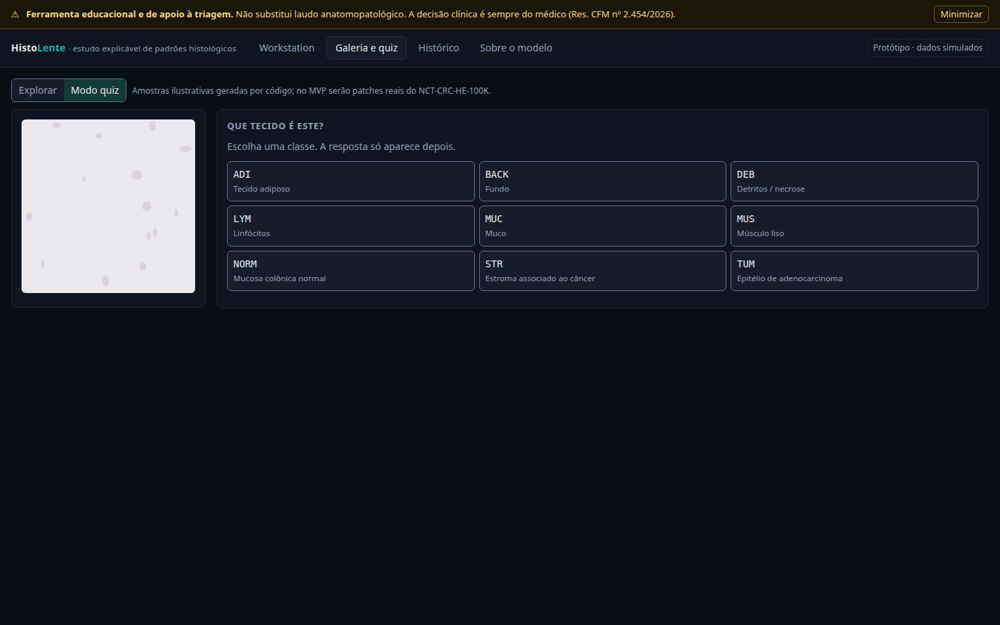
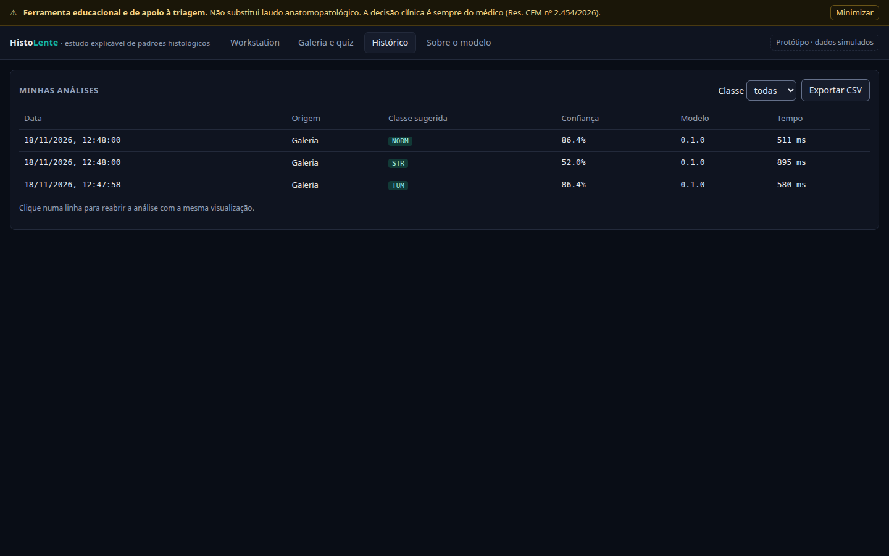
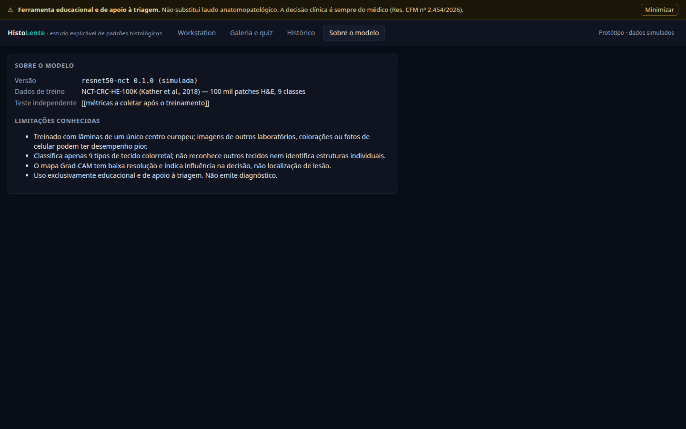
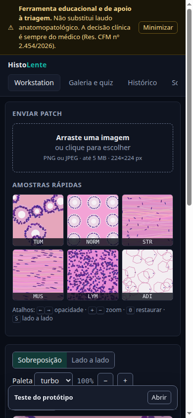

# 4. Design de Interface (UX/UI)

## 4.1 Conceito: "Clinical Dark Workstation"
Estação de trabalho escura, densa e silenciosa, em que **a lâmina é a protagonista**. A interface usa tons neutros escuros e acentos frios (*teal* e esmeralda) para não competir com o rosa da eosina e o roxo da hematoxilina, e para reduzir a fadiga visual em aulas longas.

## 4.2 Wireframes e protótipo navegável
- **Protótipo navegável:** [`prototipo/index.html`](../../prototipo/index.html). Abre direto no navegador, sem instalação, e todos os dados são simulados.
- As telas funcionam como wireframes de alta fidelidade:

| Tela | O que valida | Requisitos |
|---|---|---|
| Workstation — estado vazio | Primeiro contato; caminho para galeria e envio | RF01, RF07 |
| Workstation — análise em andamento | *Skeleton* e retorno de progresso | RNF01, HU19 |
| Workstation — resultado | Barras de confiança com *tooltips*, Grad-CAM com opacidade, modo lado a lado com zoom sincronizado, alerta de baixa confiança | RF02–RF04, RN03 |
| Galeria e quiz | Amostras por classe; quiz com erro explicado | RF01, RF09 |
| Histórico | Lista com filtros e reabertura | RF06 |
| Sobre o modelo | Versão, métricas e limitações | RF11 |

> As imagens histológicas do protótipo são **ilustrações geradas por código**, não imagens reais do dataset. No MVP, a galeria usará *patches* do NCT-CRC-HE-100K.

### Telas do protótipo

**Figura 2 — Workstation no primeiro acesso (estado vazio)**

Fonte: elaborado pelo autor (2026).

**Figura 3 — Resultado com alerta de baixa confiança, barras das 9 classes e Grad-CAM sobreposto**

Fonte: elaborado pelo autor (2026).

**Figura 4 — Modo lado a lado: patch e mapa Grad-CAM com zoom sincronizado**

Fonte: elaborado pelo autor (2026).

**Figura 5 — Galeria com amostras das 9 classes**

Fonte: elaborado pelo autor (2026).

**Figura 6 — Modo quiz: o estudante escolhe a classe antes de ver a resposta**

Fonte: elaborado pelo autor (2026).

**Figura 7 — Histórico de análises com filtro e exportação CSV**

Fonte: elaborado pelo autor (2026).

**Figura 8 — Sobre o modelo: versão e limitações**

Fonte: elaborado pelo autor (2026).

**Figura 9 — Celular, com o painel do teste remoto recolhido**

Fonte: elaborado pelo autor (2026).

## 4.3 Guia de estilo

### Cores
| Token | Valor | Uso | Contraste sobre `--bg` |
|---|---|---|---|
| `--bg` | `#090D16` | Fundo da aplicação | — |
| `--surface-1` | `#0F1420` | Painéis | — |
| `--surface-2` | `#161C2B` | Cards, popovers | — |
| `--border` | `#232A3B` | Divisórias decorativas (não identificam controles sozinhas) | 1,4:1 |
| `--border-strong` | `#64708A` | Borda de campos e controles interativos | 3,9:1 ✅ (3,4:1 sobre `--surface-2`) |
| `--text` | `#E6E9EF` | Texto principal | 16,0:1 ✅ |
| `--text-muted` | `#94A0B8` | Texto secundário | 7,4:1 ✅ |
| `--accent` | `#14B8A6` | Ação primária, foco, classe sugerida | 7,8:1 ✅ |
| `--accent-2` | `#10B981` | Sucesso, conclusão | 7,7:1 ✅ |
| `--warn` | `#F59E0B` | Aviso ético, baixa confiança | 9,0:1 ✅ |
| `--danger` | `#F97316` | Erro (laranja; nunca vermelho) | 6,9:1 ✅ |

**Regras de cor:**
- Nunca usar vermelho, rosa ou roxo como cor de interface, para não confundir com a coloração H&E.
- Toda informação transmitida por cor também aparece como texto ou ícone.
- Mapas de calor usam as paletas *turbo* ou *viridis*, que são legíveis por daltônicos.

### Tipografia
| Uso | Fonte | Tamanho / peso |
|---|---|---|
| Interface | Inter | 14 px (corpo), 12 px (secundário), 16–20 px semibold (títulos) |
| Números, percentuais, latências, *hashes* | JetBrains Mono | 13 px, `tabular-nums` |

### Espaçamento, formas e movimento
- Grade de 4 px; espaçamentos de 8, 12, 16 e 24 px.
- Raio de 8 px em cards e 6 px em campos.
- Bordas de 1 px; sem sombras pesadas.
- Animações de 150 a 250 ms, desativadas quando o usuário configurou o sistema para reduzir movimento (`prefers-reduced-motion`).
- A imagem histológica nunca é animada.

### Componentes
| Componente | Comportamento-chave |
|---|---|
| Banner ético | Fixo no topo; pode ser minimizado, nunca removido (RF07) |
| Área de envio | Arrastar e soltar, clique ou Ctrl+V; valida antes de enviar |
| Visualizador | Zoom de 1× a 8× com a roda do mouse; arraste para mover; tecla `0` restaura |
| Controle de opacidade | 0–100% (padrão 40%); setas do teclado mudam de 5 em 5% |
| Barras de confiança | 9 barras ordenadas; classe sugerida em *teal*; *tooltip* morfológico |
| Alerta de baixa confiança | Âmbar, com ícone e texto (RN03) |
| Tabela de histórico | Paginada, com filtros e reabertura |

## 4.4 Critérios de acessibilidade (WCAG 2.2, nível AA)
| Critério WCAG | Como é atendido |
|---|---|
| 1.1.1 Conteúdo não textual | Imagens com texto alternativo; mapa de calor descrito pelo nome da classe e pela confiança |
| 1.4.1 Uso de cor | Classe sugerida e alertas também indicados por texto e ícone |
| 1.4.3 Contraste mínimo (4,5:1) | Todos os tokens de texto atingem pelo menos 6,9:1 sobre o fundo (valores calculados pela fórmula de luminância relativa da WCAG) |
| 1.4.11 Contraste de elementos não textuais (3:1) | Foco (7,8:1) e barras preenchidas atendem; campos e controles usam `--border-strong` (≥ 3,4:1). A borda decorativa `--border` (1,4:1) não é usada para identificar controles |
| 2.1.1 Teclado | Todas as funções têm atalho ou foco: `←/→` opacidade, `+/−` zoom, `0` reset, `S` lado a lado, `G` galeria |
| 2.4.7 Foco visível | Contorno *teal* de 2 px em todos os elementos focáveis |
| 2.4.11 Foco não encoberto | O banner fixo não cobre o elemento focado |
| 2.5.8 Tamanho do alvo (24 × 24 px) | Botões e controles com área clicável de pelo menos 24 px |
| 3.3.1 Identificação de erros | Erros de envio explicam a causa e como corrigir |
| 4.1.2 Nome, função e valor | Controle de opacidade com `aria-valuetext` ("Opacidade do mapa: 40%"); barras com rótulo textual |
| 2.3.3 Animação por interação | Respeita a configuração de reduzir movimento |

## 4.5 Validação do protótipo com usuários

**Formato:** teste de usabilidade **remoto e não moderado**. Os participantes moram em outro município, por isso não há sessão presencial nem gravação.

**Protocolo:**
1. O participante recebe dois links: o protótipo em modo de teste (`index.html?teste`) e o formulário de avaliação. O formulário é gerado por `docs/pesquisa/criar-formulario-avaliacao-prototipo.gs` e contém o TCLE.
2. No protótipo, um painel mostra as 4 tarefas, que o participante marca ao concluir:
   - analisar uma amostra rápida;
   - ajustar a opacidade, usar o lado a lado e o zoom;
   - responder no modo quiz;
   - reabrir uma análise do histórico.
   O botão do formulário só é liberado depois das 4 tarefas.
3. No formulário, o participante informa o resultado de cada tarefa (sem dificuldade / com dificuldade / não conseguiu) e o que aconteceu, e responde ao SUS completo (10 itens) e a duas perguntas abertas.
4. O protótipo não envia dados: o registro das tarefas fica só no navegador do participante.

**Análise:**
- Taxa de conclusão de cada tarefa (meta do RNF02: pelo menos 90% sem ajuda).
- Escore SUS por participante e média, com o cálculo de Brooke (1996).
- Dificuldades relatadas, convertidas em itens do backlog.

**Limitação:** sem observação direta, o teste depende do que o participante relata. Não se mede o tempo das tarefas nem se vê onde a pessoa hesitou.

**Situação em 18/11/2026:** protótipo com modo de teste e formulário de avaliação prontos; aplicação aos participantes em andamento. Os resultados (taxa de conclusão das tarefas e escore SUS) serão anexados a este documento ao fim da coleta.
